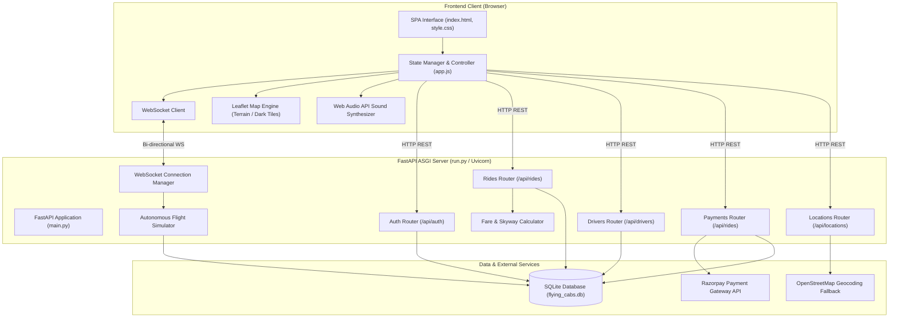
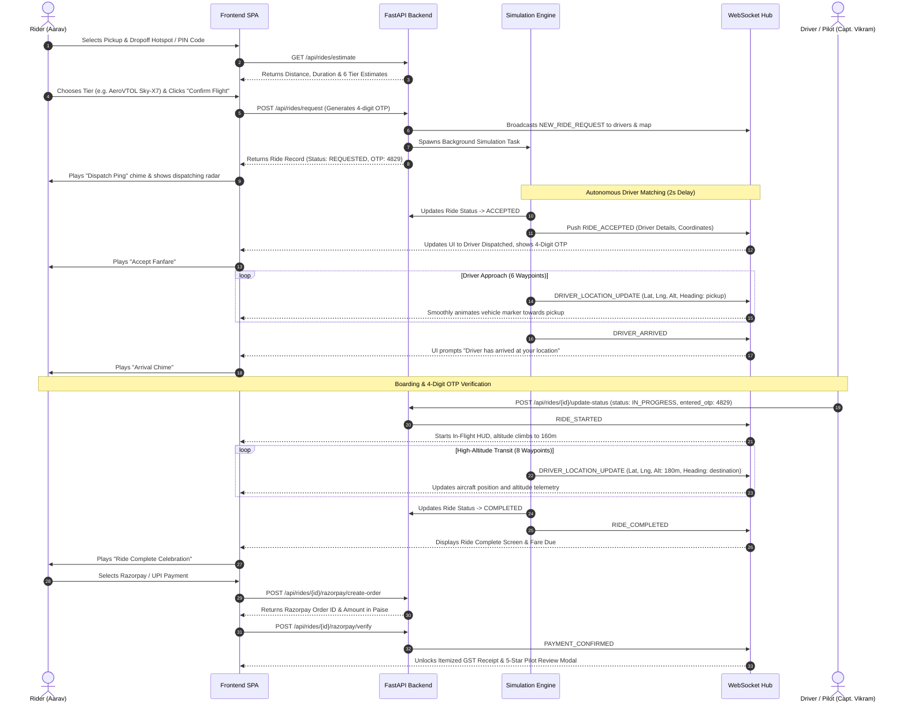
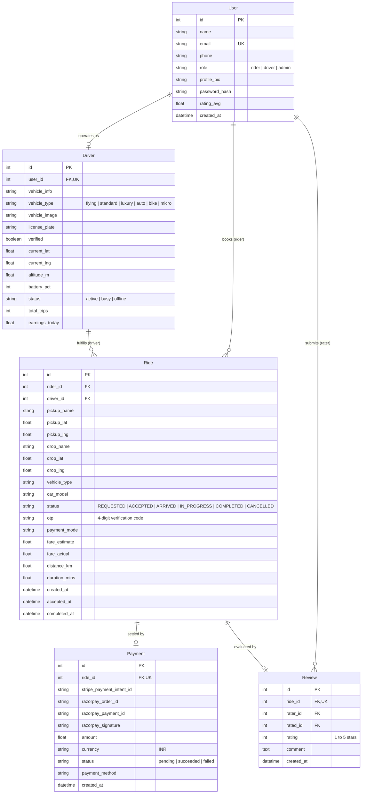

# 🛸 Flying Cabs — Complete System & Technical Documentation
> **Next-Gen Aero Mobility & Multi-Modal Ride-Hailing Platform (Ola & Uber Bharat Edition)**  
> Built with FastAPI, Leaflet Maps, Real-time WebSockets, SQLite, Razorpay Payments, and Autonomous Telemetry.

[](https://github.com/sayan-kundu000/Flying-Cabs)
[](https://fastapi.tiangolo.com/)
[](https://python.org/)
[](https://leafletjs.com/)
[](https://developer.mozilla.org/en-US/docs/Web/API/WebSockets_API)
[](https://razorpay.com/)
[](https://pytest.org/)

---

## 📑 Table of Contents
1. [Executive Overview](#1-executive-overview)
2. [System Architecture & Data Flow](#2-system-architecture--data-flow)
3. [Technology Stack Matrix](#3-technology-stack-matrix)
4. [Database Models & Entity Relationships](#4-database-models--entity-relationships)
5. [REST API Specifications](#5-rest-api-specifications)
   - [Authentication & User Management (`/api/auth`)](#authentication--user-management-apiauth)
   - [Drivers & Telemetry (`/api/drivers`)](#drivers--telemetry-apidrivers)
   - [Rides & Booking Lifecycle (`/api/rides`)](#rides--booking-lifecycle-apirides)
   - [Payments, Receipts & Reviews (`/api/rides`)](#payments-receipts--reviews-apirides)
   - [Pan-India Locations & Geocoding (`/api/locations`)](#pan-india-locations--geocoding-apilocations)
6. [Real-Time WebSocket Protocol](#6-real-time-websocket-protocol)
7. [Core Algorithms & Business Logic](#7-core-algorithms--business-logic)
   - [Haversine Distance Calculation](#haversine-distance-calculation)
   - [Multi-Modal Tiered Pricing Engine](#multi-modal-tiered-pricing-engine)
   - [Autonomous Flight & Telemetry Simulation](#autonomous-flight--telemetry-simulation)
   - [4-Digit OTP Ride Verification](#4-digit-otp-ride-verification)
   - [GST & Air Corridor Fare Breakdown](#gst--air-corridor-fare-breakdown)
8. [Pan-India Geocoding & Hotspot Engine](#8-pan-india-geocoding--hotspot-engine)
9. [Payment Gateway Architecture (Razorpay & UPI)](#9-payment-gateway-architecture-razorpay--upi)
10. [Web Audio Procedural Sound Synthesizer](#10-web-audio-procedural-sound-synthesizer)
11. [Frontend User Experience & Context Modes](#11-frontend-user-experience--context-modes)
12. [Environment Configuration Reference](#12-environment-configuration-reference)
13. [Testing & Quality Assurance](#13-testing--quality-assurance)
14. [Local Setup & Containerized Deployment](#14-local-setup--containerized-deployment)
15. [Git Workflow & Maintenance](#15-git-workflow--maintenance)

---

## 1. Executive Overview

**Flying Cabs** is an advanced urban transit platform bridging ground transportation with high-altitude urban air mobility (eVTOL sky transit). Designed with an Indian market lens ("Bharat Edition"), it offers end-to-end multi-modal transit options:
- **🛺 Ola / Uber Auto**: Iconic 3-wheeler EV auto rickshaw for fast intra-city street navigation.
- **🚗 Ola Micro / UberGo**: Budget-friendly compact hatchbacks (Tata Tiago EV, WagonR).
- **🚖 Ola Mini / UberX**: Standard comfortable AC sedans (Tata Tigor EV Prime).
- **⚡ Ola Prime / Uber Premier**: Luxury executive cruisers (Mercedes-Benz E-Class).
- **🏍️ Ola Bike / Uber Moto**: Single-passenger two-wheeler bike taxi for traffic evasion.
- **🛸 AeroCab Sky-X7 (Air Garuda)**: Next-gen electric Vertical Takeoff and Landing (eVTOL) flying cab cruising at 150m–180m altitude at 120 km/h, bypassing 100% of street-level congestion.

The application features full real-time telemetry streaming over WebSockets, procedural sound effects synthesizers, simulated and live Razorpay payment processing with GST receipts, Indian PIN code geocoding, and multi-tier persona simulation.

---

## 2. System Architecture & Data Flow

### High-Level Architecture



### Complete Ride Lifecycle Flow



---

## 3. Technology Stack Matrix

| Layer | Technology | Version | Purpose |
|---|---|---|---|
| **Language** | Python | `3.12+` | Backend programming language |
| **Framework** | FastAPI | `0.115+` | High-performance asynchronous REST & ASGI web framework |
| **ASGI Server** | Uvicorn | `0.34+` | Production ASGI web server running with multi-port detection |
| **Database ORM** | SQLAlchemy | `2.0+` | Relational database mapping, automated schema migrations, relationships |
| **Data Validation** | Pydantic v2 | `2.10+` | Strict schema validation, request filtering, serialization |
| **Database** | SQLite | `3.x` | Embedded relational database with WAL-mode journaling |
| **Payments** | Razorpay Python SDK | `1.4+` | Order creation, HMAC-SHA256 signature verification, UPI integration |
| **Maps & Tiles** | Leaflet.js | `1.9.4` | Interactive mobile-responsive map engine with custom markers and polyline vectors |
| **Audio** | Native Web Audio API | Standard | Zero-asset procedural oscillator sound synthesizer |
| **Real-time Comms** | WebSockets | Standard | Bi-directional low-latency event bus for rider, pilot, and radar channels |
| **Test Engine** | Pytest | `9.1+` | Automated regression test suite with 15 passing test cases |
| **Container** | Docker & Compose | Multi-stage | Alpine/slim containerization for reproducible production deployments |

---

## 4. Database Models & Entity Relationships

The database is built on SQLAlchemy declarative base (`backend/app/database.py`). It consists of 5 core relational models:



---

## 5. REST API Specifications

The base path for all REST endpoints is `/api`. Interactive OpenAPI Swagger documentation is available locally at `http://127.0.0.1:3000/docs`.

### Authentication & User Management (`/api/auth`)

| Method | Endpoint | Description | Request Body / Query Params | Response |
|---|---|---|---|---|
| `GET` | `/api/auth/avatars` | List curated Indian profile face photos for riders & pilots | None | Array of avatar objects with name, role, photo URL |
| `GET` | `/api/auth/users` | List all registered demo users | None | `List[UserResponse]` |
| `POST` | `/api/auth/register` | Register new passenger or driver partner | `UserRegisterRequest` (name, email, password, role, vehicle_info, etc.) | `AuthSessionResponse` with JWT token and user profile |
| `POST` | `/api/auth/login` | Authenticate user via email or mobile phone | `UserLoginRequest` (email_or_phone, password) | `AuthSessionResponse` |
| `GET` | `/api/auth/me` | Fetch currently logged in user profile | `?user_id=1` (optional) | `UserResponse` |
| `POST` | `/api/auth/quick-switch/{user_id}` | Instant 1-click persona switching for testing | Route param `user_id` | `AuthSessionResponse` |
| `GET / POST` | `/api/auth/session` | Validate session token / simulate Clerk authentication | `?email=aarav.sharma@aerocabs.in` | `UserResponse` |

### Drivers & Telemetry (`/api/drivers`)

| Method | Endpoint | Description | Query / Body Params | Response |
|---|---|---|---|---|
| `GET` | `/api/drivers/nearby` | Geospatial lookup with auto-distribution | `lat`, `lng`, `radius_km` (default 35), `vehicle_type` | `List[DriverResponse]` |
| `GET` | `/api/drivers/{driver_id}/dashboard` | Driver shift metrics, daily earnings, active trips | Route param `driver_id` | Driver summary object with earnings and pending trips |
| `POST` | `/api/drivers/{driver_id}/location` | Driver publishes telemetry (lat, lng, altitude, battery) | `DriverLocationUpdate` | `{"status": "ok", "driver_id": id}` |
| `POST` | `/api/drivers/{driver_id}/status` | Toggle driver availability (`active`, `offline`) | `DriverStatusUpdate` | `{"status": "ok", "new_status": "..."}` |

### Rides & Booking Lifecycle (`/api/rides`)

| Method | Endpoint | Description | Parameters / Payload | Response |
|---|---|---|---|---|
| `GET` | `/api/rides/estimate` | Compute route distance, ETA, tiered multi-modal pricing | `origin_lat`, `origin_lng`, `dest_lat`, `dest_lng` | `FareEstimateResponse` (distance, duration, 6 tier options) |
| `POST` | `/api/rides/request` | Dispatch ride, generate OTP, trigger WebSocket alert | `RideCreate` (rider_id, pickup/drop coordinates, vehicle_type, etc.) | `RideResponse` |
| `GET` | `/api/rides/{ride_id}/status` | Retrieve live ride status, driver details, and OTP | Route param `ride_id` | `RideResponse` |
| `POST` | `/api/rides/{ride_id}/accept` | Driver accepts dispatched trip | `ride_id` in path, `driver_id` in query | `RideResponse` (status: `ACCEPTED`) |
| `POST` | `/api/rides/{ride_id}/update-status` | Advance status (`ARRIVED`, `IN_PROGRESS`, `COMPLETED`) | `RideStatusUpdate` with optional `entered_otp` | `RideResponse` |
| `POST` | `/api/rides/{ride_id}/cancel` | Abort ride and terminate background simulation | Route param `ride_id` | `{"status": "ok", "message": "Ride cancelled"}` |
| `GET` | `/api/rides/history` | Past ride records | `?user_id=1` (optional) | `List[RideResponse]` |
| `GET` | `/api/rides/config/keys` | View active Google Maps & Razorpay public keys | None | `ApiConfigResponse` |
| `POST` | `/api/rides/config/keys` | Dynamically update API keys and persist to `.env` | `ApiConfigUpdateRequest` | `ApiConfigResponse` |

### Payments, Receipts & Reviews (`/api/rides`)

| Method | Endpoint | Description | Payload | Response |
|---|---|---|---|---|
| `GET` | `/api/rides/razorpay/config` | Public Razorpay parameters for checkout modal | None | `RazorpayConfigResponse` (key_id, currency, theme_color) |
| `POST` | `/api/rides/{ride_id}/razorpay/create-order` | Create Razorpay order (converted to paise) | `RazorpayOrderCreateRequest` | `RazorpayOrderResponse` (order_id, amount in paise, receipt) |
| `POST` | `/api/rides/{ride_id}/razorpay/verify` | Verify Razorpay payment signature & record settlement | `RazorpayVerifyRequest` (order_id, payment_id, signature) | `PaymentResponse` |
| `POST` | `/api/rides/{ride_id}/pay` | Direct payment confirmation (UPI, Card, Wallet) | `RidePayRequest` | `PaymentResponse` |
| `POST` | `/api/rides/{ride_id}/review` | Submit pilot/driver star rating (1–5) and comment | `RideReviewRequest` | `ReviewResponse` (recomputes driver average) |
| `GET` | `/api/rides/{ride_id}/receipt` | Generate itemized flight invoice with 5% GST breakdown | Route param `ride_id` | Full receipt JSON with invoice number and tax calculations |

### Pan-India Locations & Geocoding (`/api/locations`)

| Method | Endpoint | Description | Query Parameters | Response |
|---|---|---|---|---|
| `GET` | `/api/locations/search` | Search 250+ hotspots, 6-digit PIN codes, and addresses | `q` (query string), `city` (optional bias) | Array of matched location items with coordinates and icons |
| `GET` | `/api/locations/reverse` | Reverse geocode latitude and longitude to street address | `lat`, `lng` | Location object with name, subdistrict, and city |
| `GET` | `/api/locations/hotspots` | Return curated quick-pick hotspots for a city | `city` (e.g. `bengaluru`, `delhi`, `mumbai`) | Array of top 6 landmark hotspots |

---

## 6. Real-Time WebSocket Protocol

The system provides 3 bi-directional WebSocket endpoints managed by `backend/app/services/websocket_manager.py`:

```
ws://127.0.0.1:3000/ws/rider/{rider_id}
ws://127.0.0.1:3000/ws/driver/{driver_id}
ws://127.0.0.1:3000/ws/map
```

### Event Specifications

#### 1. Rider Channel (`/ws/rider/{rider_id}`)
- **`RIDE_ACCEPTED`**: Triggered when a driver accepts the trip.
  ```json
  {
    "type": "RIDE_ACCEPTED",
    "ride_id": 14,
    "status": "ACCEPTED",
    "otp": "4829",
    "driver": {
      "id": 1,
      "name": "Capt. Vikram Rathore",
      "phone": "+91 98450 11007",
      "vehicle_info": "AeroVTOL Sky-X7 (Air Garuda)",
      "vehicle_type": "flying",
      "license_plate": "KA-01-AERO-007",
      "altitude_m": 160.0,
      "battery_pct": 98
    }
  }
  ```
- **`DRIVER_LOCATION_UPDATE`**: Streamed every 1.2s as the vehicle navigates towards pickup or destination.
  ```json
  {
    "type": "DRIVER_LOCATION_UPDATE",
    "ride_id": 14,
    "driver_id": 1,
    "lat": 12.9745,
    "lng": 77.6250,
    "altitude_m": 180.0,
    "step": 3,
    "heading_to": "destination"
  }
  ```
- **`DRIVER_ARRIVED`**: Sent when vehicle reaches pickup coordinates.
- **`RIDE_STARTED`**: Sent upon passenger boarding and OTP validation.
- **`RIDE_COMPLETED`**: Sent upon touchdown at destination coordinates.
- **`PAYMENT_CONFIRMED`**: Pushed immediately when payment is verified.
- **`RIDE_CANCELLED`**: Pushed if either party aborts the trip.

#### 2. Driver Channel (`/ws/driver/{driver_id}`)
- **`NEW_RIDE_REQUEST`**: Notifies nearby online drivers of an incoming booking with pickup, dropoff, fare, and distance.
- **`RIDE_CANCELLED`**: Alerts the pilot that the requested trip was cancelled.

#### 3. Global Map Radar Channel (`/ws/map`)
- **`FLEET_LOCATION_UPDATE`**: Broadcasts telemetry across all active aircraft and cars to render the ATC Air Traffic Radar.
- **`RIDE_REQUESTED`** & **`RIDE_UPDATED`**: Live corridor visualization for global monitoring.
- **`DRIVER_STATUS_CHANGE`**: Real-time fleet availability toggles.

---

## 7. Core Algorithms & Business Logic

### Haversine Distance Calculation
The platform computes spherical surface distance using the Haversine formula (`backend/app/services/fare_calculator.py`):

$$\Delta\text{lat} = \text{lat}_2 - \text{lat}_1, \quad \Delta\text{lon} = \text{lon}_2 - \text{lon}_1$$
$$a = \sin^2\left(\frac{\Delta\text{lat}}{2}\right) + \cos(\text{lat}_1)\cos(\text{lat}_2)\sin^2\left(\frac{\Delta\text{lon}}{2}\right)$$
$$c = 2 \cdot \text{atan2}\left(\sqrt{a}, \sqrt{1 - a}\right), \quad \text{Distance} = R \cdot c \quad (R = 6371.0 \text{ km})$$

### Multi-Modal Tiered Pricing Engine
Each vehicle tier has customized parameters tailored to Indian urban commute realities:

| Tier ID | Vehicle Tier | Model Example | Base Fare (₹) | Per KM (₹) | Per Min (₹) | Avg Speed | Speed Factor |
|---|---|---|---|---|---|---|---|
| `auto` | Ola Auto / Uber Auto | Bajaj RE EV Auto | ₹35.00 | ₹12.00 | ₹1.50 | 24 km/h | 1.1x |
| `micro` | Ola Micro / UberGo | Tata Tiago EV / WagonR | ₹50.00 | ₹13.50 | ₹2.00 | 26 km/h | 1.0x |
| `standard` | Ola Mini / UberX | Tata Tigor EV Prime | ₹80.00 | ₹16.00 | ₹2.50 | 28 km/h | 1.05x |
| `luxury` | Ola Prime / Premier | Mercedes-Benz E-Class | ₹150.00 | ₹24.00 | ₹3.50 | 30 km/h | 1.2x |
| `bike` | Ola Bike / Moto | Ather 450X EV Bike | ₹25.00 | ₹8.00 | ₹1.00 | 35 km/h | 1.4x |
| `flying` | AeroCab VTOL | AeroVTOL Sky-X7 | ₹450.00 | ₹38.00 | ₹5.00 | 120 km/h | 3.5x |

**Fare Formula**:
$$\text{Fare} = \text{Base Fare} + (\text{Distance}_{\text{km}} \times \text{Per KM Rate}) + (\text{Duration}_{\text{mins}} \times \text{Per Minute Rate})$$
Fares are automatically rounded to the nearest whole rupee in accordance with Indian transportation conventions.

### Autonomous Flight & Telemetry Simulation
When a ride is requested (`backend/app/services/simulation_service.py`), an asynchronous worker manages realistic multi-phase movement:
1. **Linear Interpolation**:
   $$P(t) = P_{\text{start}} + (P_{\text{target}} - P_{\text{start}}) \cdot t, \quad t \in [0, 1]$$
2. **Phase 1 (Pickup Approach)**: 6 stepwise waypoints (1.2s intervals) simulating driver approach.
3. **Phase 2 (Touchdown / Arrival)**: Status set to `ARRIVED`.
4. **Phase 3 (Takeoff & Climb)**: Altitude climbs from ground level to 160m–180m cruising corridor.
5. **Phase 4 (In-Flight Transit)**: 8 waypoints towards destination vector at 120 km/h.
6. **Phase 5 (Touchdown & Completion)**: Status set to `COMPLETED`, driver shifts to `active`, and earnings are incremented.

### 4-Digit OTP Ride Verification
To replicate the security standard of Ola and Uber India:
- A random 4-digit code (e.g. `4829`) is generated upon ride booking.
- Displayed prominently in the rider's active tracking drawer.
- The driver cannot advance the trip from `ARRIVED` to `IN_PROGRESS` without supplying the exact matching OTP.

### GST & Air Corridor Fare Breakdown
Generated on `/api/rides/{id}/receipt`:
- **Base Fare**: ₹499.00 (Flying VTOL) or ₹99.00 (Ground cabs)
- **Distance Charge**: 65% of net fare
- **Sky-Corridor Surcharge**: 15% (applies only to VTOL flights)
- **GST (Goods & Services Tax)**: 5% statutory tax for Indian passenger transport services

---

## 8. Pan-India Geocoding & Hotspot Engine

`backend/app/routers/locations.py` provides an offline-first, high-precision search engine for India:
1. **Curated Landmark Index**: Over 250+ pre-indexed hotspots across Delhi NCR, Mumbai, Bengaluru, Hyderabad, Chennai, Kolkata, Pune, Ahmedabad, Jamshedpur, Jaipur, etc.
2. **6-Digit PIN Code Direct Match**: Instant lookup for major Indian postal codes (e.g. `560001` Bengaluru CBD, `110001` Connaught Place, `400051` Mumbai BKC, `831001` Jamshedpur).
3. **Prefix PIN Code Matching**: Typing `5600` immediately returns candidate pincode sectors.
4. **Relevance Scoring Engine**:
   - Exact name match: +20 points
   - Prefix match: +10 points
   - Keyword / PIN match: +25 points
   - Selected city affinity: +8 points
5. **Dynamic Remote Fallback**: Automatically queries OpenStreetMap Nominatim with rate-limiting and in-memory LRU caching if local search yields fewer than 5 results.

---

## 9. Payment Gateway Architecture (Razorpay & UPI)

The payment subsystem supports seamless transactions in Indian Rupees (₹ INR):
- **Razorpay Orders API**: Amounts in INR are multiplied by 100 to convert to paise (`₹1499.00` $\rightarrow$ `149900` paise).
- **Frontend Checkout Integration**: The client dynamically loads the official Razorpay Checkout script (`checkout.razorpay.com/v1/checkout.js`).
- **Signature Verification**: Validates HMAC-SHA256 signatures (`razorpay_signature`) using the configured `RAZORPAY_KEY_SECRET`.
- **Intelligent Sandbox Fallback**: If using mock or development keys, the server seamlessly completes simulated payment intents with instant WebSocket confirmations.

---

## 10. Web Audio Procedural Sound Synthesizer

The frontend uses the HTML5 **Web Audio API** (`frontend/app.js: SoundSynthesizer`) without requiring external MP3 or WAV files:
- **`click`**: High-frequency short sine tap (800Hz $\rightarrow$ 400Hz, 50ms).
- **`dispatch`**: Alternating dual-frequency chime (750Hz $\rightarrow$ 950Hz) mimicking Ola/Uber ride dispatch.
- **`accept`**: Rising arpeggio triad (C5 `523Hz` $\rightarrow$ E5 `659Hz` $\rightarrow$ G5 `784Hz`).
- **`arrived`**: Two-tone melodic arrival ping (A5 `880Hz` $\rightarrow$ D6 `1175Hz`).
- **`otp_verified`**: Low-to-high confirmation chime (D5 `587Hz` $\rightarrow$ A5 `880Hz`).
- **`complete`**: Triple-tone celebration chime (E5 $\rightarrow$ A5 $\rightarrow$ E6).

---

## 11. Frontend User Experience & Context Modes

The frontend is an ultra-modern, glassmorphic dark-themed SPA:
- **Rider Mode**:
  - Hotspot quick-selector chips for popular airports, tech hubs, and stations.
  - Interactive Leaflet map with direct coordinate picking.
  - Vehicle tier carousel with live pricing, driver photos, car photos, and ratings.
  - Live ride tracking drawer with 4-digit OTP badge, pilot contact card, and emergency cancellation.
  - Razorpay payment checkout modal & itemized GST receipt viewer.
  - 5-star pilot review modal.
- **Driver Cockpit**:
  - Availability toggle (`active` / `offline`).
  - Shift dashboard showing daily earnings in ₹, completed trips, and active vehicle telemetry.
  - Real-time incoming ride request cards with accept/reject buttons.
  - Manual trip status progression controls with OTP entry validation.
- **Fleet Radar (ATC)**:
  - High-altitude Air Traffic Control overview showing all active flying cabs and ground cabs across India.
  - Aircraft altitude tags (e.g. `160m Alt`), battery percentages, and flight speed vectors.
- **Persona Quick-Switch**:
  - 1-click switcher in the header to alternate seamlessly between passenger accounts (Aarav, Priya, Ananya) and pilot accounts (Capt. Vikram, Rajesh, Manjunath).

---

## 12. Environment Configuration Reference

The application loads environment variables from `.env` using Pydantic Settings (`backend/app/config.py`). A sanitized template is provided in `.env.example`:

```env
# Application Environment
ENVIRONMENT=development
PORT=3000
SECRET_KEY=super-secret-flying-cabs-key-2026-bharat
DATABASE_URL=sqlite:///./flying_cabs.db
SIMULATION_AUTO_DRIVER=True

# Google Maps & Terrain API Configuration
GOOGLE_MAPS_API_KEY=your_google_maps_key_here
GOOGLE_MAPS_MAP_TYPE=terrain

# Razorpay Payment Gateway Configuration
RAZORPAY_KEY_ID=rzp_test_your_key_id
RAZORPAY_KEY_SECRET=your_razorpay_secret
RAZORPAY_CURRENCY=INR
MERCHANT_NAME=Flying Cabs (Ola-Uber India)
```

---

## 13. Testing & Quality Assurance

The codebase includes an automated test suite in `tests/test_api.py` covering 15 test scenarios:

```powershell
py -3.12 -m pytest tests/test_api.py -v
```

### Verified Test Cases
1. `test_health_check`: Validates `/health` status and version response.
2. `test_auth_session`: Confirms user session retrieval and fallback.
3. `test_nearby_drivers`: Tests geospatial driver search and auto-distribution.
4. `test_fare_estimate`: Checks Haversine calculation and 6-tier pricing.
5. `test_ride_lifecycle`: Full cycle (`REQUESTED` $\rightarrow$ `ACCEPTED` $\rightarrow$ `ARRIVED` $\rightarrow$ `IN_PROGRESS` $\rightarrow$ `COMPLETED`).
6. `test_ride_history`: Confirms persistence and user trip history retrieval.
7. `test_razorpay_config`: Verifies public payment configuration endpoints.
8. `test_razorpay_order_and_verify`: Validates order creation in paise and payment verification.
9. `test_api_config_keys`: Tests dynamic key retrieval and update APIs.
10. `test_pan_india_fleet`: Validates multi-city pilot seeding across Delhi, Mumbai, Bengaluru, etc.
11. `test_ride_otp`: Validates 4-digit OTP generation and strict validation before ride start.
12. `test_register_and_login`: Tests SHA-256 user registration and authentication.
13. `test_curated_avatars`: Validates Indian avatar catalog.
14. `test_location_search_and_reverse`: Tests hotspot lookup and reverse geocoding.
15. `test_pincode_search_and_endpoint`: Tests 6-digit postal code resolution.

---

## 14. Local Setup & Containerized Deployment

### Option A: Standard Local Setup

1. **Clone the repository**:
   ```bash
   git clone https://github.com/sayan-kundu000/Flying-Cabs.git
   cd Flying-Cabs
   ```

2. **Install Python dependencies**:
   ```powershell
   py -3.12 -m pip install -r requirements.txt
   ```

3. **Launch the platform**:
   ```powershell
   py run.py
   ```
   *The launcher automatically detects port conflicts, binds to port 3000 (with port 8000 compatibility), and opens your browser directly to the web app.*

### Option B: Docker Deployment

1. **Build and start via Docker Compose**:
   ```bash
   docker-compose up --build
   ```

2. Access the application at `http://localhost:3000`.

---

## 15. Git Workflow & Maintenance

### Commit & Push Updates
When adding features or making changes, push updates directly to GitHub:

```bash
# Check modified files
git status

# Stage changes
git add .

# Commit with descriptive message
git commit -m "feat: Add new telemetry radar filter"

# Push to main branch
git push origin main
```

---

*Authored for Flying Cabs — Next-Gen Urban Aero Mobility Platform.*  
*Repository: [https://github.com/sayan-kundu000/Flying-Cabs](https://github.com/sayan-kundu000/Flying-Cabs)*
