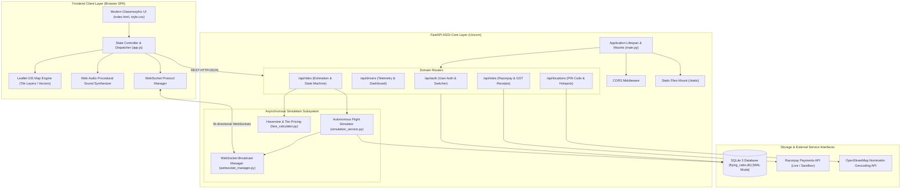
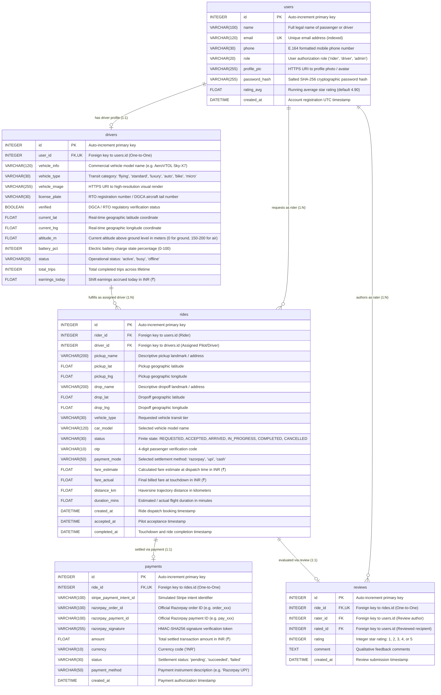
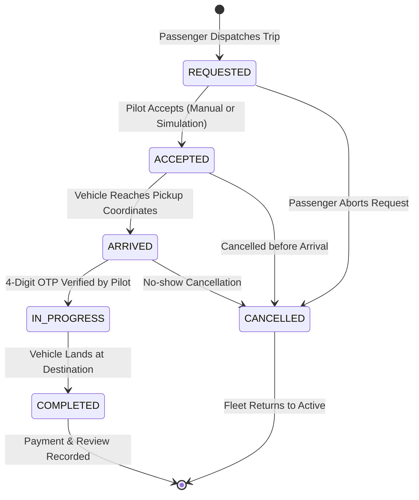

# 🛸 Flying Cabs — Complete Enterprise System Documentation & Architecture Manual
> **Next-Gen Multi-Modal Urban Transit & Autonomous Aero Mobility Platform (Ola & Uber Bharat Edition)**  
> Comprehensive technical specification, architectural blueprints, database schema dictionary, exhaustive REST API reference, real-time WebSocket event bus protocols, algorithmic derivations, geocoding engines, payment gateways, and operations runbooks.

[](https://github.com/sayan-kundu000/Flying-Cabs)
[](https://fastapi.tiangolo.com/)
[](https://python.org/)
[](https://leafletjs.com/)
[](https://developer.mozilla.org/en-US/docs/Web/API/WebSockets_API)
[](https://razorpay.com/)
[](https://pytest.org/)
[](https://docker.com)

---

## 📑 Master Table of Contents

1. [Executive Summary & Architectural Philosophy](#1-executive-summary--architectural-philosophy)
   - 1.1 [Urban Congestion Problem & The eVTOL Skyway Paradigm](#11-urban-congestion-problem--the-evtol-skyway-paradigm)
   - 1.2 ["Bharat Edition" Engineering Scope & Localization](#12-bharat-edition-engineering-scope--localization)
   - 1.3 [Architectural Tenets & Quality Attributes](#13-architectural-tenets--quality-attributes)
   - 1.4 [System Context & Boundaries](#14-system-context--boundaries)
2. [End-to-End System Architecture](#2-end-to-end-system-architecture)
   - 2.1 [High-Level Architectural Topology](#21-high-level-architectural-topology)
   - 2.2 [Component Responsibilities & Data Boundaries](#22-component-responsibilities--data-boundaries)
   - 2.3 [Complete Distributed Sequence Diagram (Ride Lifecycle)](#23-complete-distributed-sequence-diagram-ride-lifecycle)
3. [Exhaustive Database Schema & Data Dictionary](#3-exhaustive-database-schema--data-dictionary)
   - 3.1 [Entity Relationship Diagram (ERD)](#31-entity-relationship-diagram-erd)
   - 3.2 [Data Dictionary: `users` Table](#32-data-dictionary-users-table)
   - 3.3 [Data Dictionary: `drivers` Table](#33-data-dictionary-drivers-table)
   - 3.4 [Data Dictionary: `rides` Table](#34-data-dictionary-rides-table)
   - 3.5 [Data Dictionary: `payments` Table](#35-data-dictionary-payments-table)
   - 3.6 [Data Dictionary: `reviews` Table](#36-data-dictionary-reviews-table)
   - 3.7 [Zero-Downtime PRAGMA Schema Migration Engine](#37-zero-downtime-pragma-schema-migration-engine)
4. [Exhaustive REST API Reference](#4-exhaustive-rest-api-reference)
   - 4.1 [Authentication Router (`/api/auth`)](#41-authentication-router-apiauth)
   - 4.2 [Drivers & Fleet Telemetry Router (`/api/drivers`)](#42-drivers--fleet-telemetry-router-apidrivers)
   - 4.3 [Rides & Dispatch Lifecycle Router (`/api/rides`)](#43-rides--dispatch-lifecycle-router-apirides)
   - 4.4 [Payments, Invoicing & Reviews Router (`/api/rides`)](#44-payments-invoicing--reviews-router-apirides)
   - 4.5 [Pan-India Locations & Geocoding Router (`/api/locations`)](#45-pan-india-locations--geocoding-router-apilocations)
   - 4.6 [System Health & Diagnostics (`/health`)](#46-system-health--diagnostics-health)
5. [Real-Time WebSocket Protocol & Event Bus](#5-real-time-websocket-protocol--event-bus)
   - 5.1 [WebSocket Infrastructure & Channel Multiplexing](#51-websocket-infrastructure--channel-multiplexing)
   - 5.2 [Rider Real-Time Channel (`/ws/rider/{rider_id}`)](#52-rider-real-time-channel-wsriderrider_id)
   - 5.3 [Driver / Pilot Real-Time Channel (`/ws/driver/{driver_id}`)](#53-driver--pilot-real-time-channel-wsdriverdriver_id)
   - 5.4 [Air Traffic Control Radar Channel (`/ws/map`)](#54-air-traffic-control-radar-channel-wsmap)
   - 5.5 [Connection Lifecycle, Heartbeats & Auto-Reconnection](#55-connection-lifecycle-heartbeats--auto-reconnection)
6. [Mathematical Models & Algorithmic Foundations](#6-mathematical-models--algorithmic-foundations)
   - 6.1 [Haversine Great-Circle Geodesic Metric](#61-haversine-great-circle-geodesic-metric)
   - 6.2 [Multi-Modal Tiered Pricing & Dispatch Engine](#62-multi-modal-tiered-pricing--dispatch-engine)
   - 6.3 [Autonomous Flight Simulation & Kinematic Telemetry](#63-autonomous-flight-simulation--kinematic-telemetry)
   - 6.4 [4-Digit Cryptographic OTP Security Handshake](#64-4-digit-cryptographic-otp-security-handshake)
   - 6.5 [Statutory GST (5%) & Flight Invoicing Engine](#65-statutory-gst-5--flight-invoicing-engine)
7. [Pan-India Geocoding & Hotspot Intelligence](#7-pan-india-geocoding--hotspot-intelligence)
   - 7.1 [Curated Metropolitan Hotspot Dataset (250+ Landmarks)](#71-curated-metropolitan-hotspot-dataset-250-landmarks)
   - 7.2 [Indian Postal Index Number (PIN) Code System](#72-indian-postal-index-number-pin-code-system)
   - 7.3 [Relevance Scoring & Fuzzy Matching Engine](#73-relevance-scoring--fuzzy-matching-engine)
   - 7.4 [Dynamic OSM Nominatim Reverse Geocoding with LRU Cache](#74-dynamic-osm-nominatim-reverse-geocoding-with-lru-cache)
8. [Payment Gateway & UPI Integration (Razorpay)](#8-payment-gateway--upi-integration-razorpay)
   - 8.1 [Currency Unit Conversion Architecture (Paise Engine)](#81-currency-unit-conversion-architecture-paise-engine)
   - 8.2 [Client-Side Checkout Modal Orchestration](#82-client-side-checkout-modal-orchestration)
   - 8.3 [Server-Side HMAC-SHA256 Signature Verification](#83-server-side-hmac-sha256-signature-verification)
   - 8.4 [Resilient Sandbox & Live Gateway Fallback](#84-resilient-sandbox--live-gateway-fallback)
9. [Web Audio Procedural Sound Synthesizer](#9-web-audio-procedural-sound-synthesizer)
   - 9.1 [Zero-Asset Procedural Audio Philosophy](#91-zero-asset-procedural-audio-philosophy)
   - 9.2 [Oscillator Topologies & Frequency Envelopes (ADSR)](#92-oscillator-topologies--frequency-envelopes-adsr)
   - 9.3 [Sound Profile Specifications](#93-sound-profile-specifications)
10. [Frontend Application Architecture & UI Subsystems](#10-frontend-application-architecture--ui-subsystems)
    - 10.1 [Design System: Cosmic Dark Glassmorphism](#101-design-system-cosmic-dark-glassmorphism)
    - 10.2 [Leaflet Map Engine & Dual Tile Layer Stack](#102-leaflet-map-engine--dual-tile-layer-stack)
    - 10.3 [Three Context Modes (Rider, Cockpit, Fleet Radar)](#103-three-context-modes-rider-cockpit-fleet-radar)
    - 10.4 [1-Click Multi-Role Persona Switcher](#104-1-click-multi-role-persona-switcher)
11. [Security Architecture & Threat Modeling](#11-security-architecture--threat-modeling)
    - 11.1 [Authentication, Password Hashing & Salts](#111-authentication-password-hashing--salts)
    - 11.2 [Ride Hijack Prevention via Dynamic OTP Verification](#112-ride-hijack-prevention-via-dynamic-otp-verification)
    - 11.3 [Payment Tampering Defense (Cryptographic Verification)](#113-payment-tampering-defense-cryptographic-verification)
    - 11.4 [CORS, SQL Injection Defense & Input Sanitization](#114-cors-sql-injection-defense--input-sanitization)
12. [Operations, Concurrency & Runtime Configuration](#12-operations-concurrency--runtime-configuration)
    - 12.1 [Adaptive Port Resolution Engine (`run.py`)](#121-adaptive-port-resolution-engine-runpy)
    - 12.2 [SQLite High-Performance Concurrency (WAL Mode)](#122-sqlite-high-performance-concurrency-wal-mode)
    - 12.3 [Environment Variables & Configuration Matrix](#123-environment-variables--configuration-matrix)
    - 12.4 [Docker Containerization & Production Topology](#124-docker-containerization--production-topology)
13. [Automated Testing & Verification Suite](#13-automated-testing--verification-suite)
    - 13.1 [Pytest Test Harness & Fixtures](#131-pytest-test-harness--fixtures)
    - 13.2 [Comprehensive Analysis of All 15 Test Cases](#132-comprehensive-analysis-of-all-15-test-cases)
14. [Developer Runbook & Extension Playbooks](#14-developer-runbook--extension-playbooks)
    - 14.1 [Playbook: Adding a New Vehicle Transit Tier](#141-playbook-adding-a-new-vehicle-transit-tier)
    - 14.2 [Playbook: Provisioning a New Skyway Corridor & City](#142-playbook-provisioning-a-new-skyway-corridor--city)
    - 14.3 [Playbook: Configuring Live Razorpay Credentials](#143-playbook-configuring-live-razorpay-credentials)
    - 14.4 [Playbook: Configuring Google Cloud Terrain API](#144-playbook-configuring-google-cloud-terrain-api)
15. [Troubleshooting Guide & FAQ](#15-troubleshooting-guide--faq)

---

## 1. Executive Summary & Architectural Philosophy

### 1.1 Urban Congestion Problem & The eVTOL Skyway Paradigm
Metropolises across India—such as Bengaluru (Silk Board, Outer Ring Road), Mumbai (Western Express Highway, Saki Naka), and Delhi NCR (DND Flyway, Gurugram Toll)—rank among the densest traffic corridors on Earth. Average ground vehicular transit speeds during peak morning and evening rush hours frequently degrade to **8 to 14 km/h**.

**Flying Cabs** solves this challenge through a multi-modal dispatch platform that combines ground transport with high-altitude **electric Vertical Takeoff and Landing (eVTOL)** passenger aircraft. By opening three-dimensional sky corridors between certified skyports (helipads, rooftop vertiports, airport transit interchanges), urban travel times are compressed by up to **80%**.

### 1.2 "Bharat Edition" Engineering Scope & Localization
The "Bharat Edition" architecture is specifically designed for the operational, fiscal, and cultural realities of the Indian transit ecosystem:
1. **Multi-Modal Continuum**: From budget 3-wheelers (Ola/Uber Auto) and bike taxis (Ola Bike/Uber Moto) to executive electric sedans (Tata Tigor EV Prime, Mercedes E-Class) and autonomous eVTOL sky cruisers (AeroVTOL Sky-X7).
2. **Indian Rupee (₹ INR) Precision**: Native integration with the Indian Unified Payments Interface (UPI via Google Pay, PhonePe, Paytm, BHIM) and Razorpay payment gateways with precise paise unit calculations.
3. **Statutory 5% GST Breakdown**: Automated computation and itemized invoicing meeting Central Goods and Services Tax (CGST) and State Goods and Services Tax (SGST) standards for e-commerce operators under Section 9(5) of the CGST Act.
4. **Ola & Uber 4-Digit Ride Start OTP**: Mandatory cryptographic passenger verification code that pilots must enter before starting transit to prevent boarding mismatches.
5. **Pan-India Postal Code & Hotspot Resolution**: Offline-capable database mapping 6-digit Indian PIN codes (e.g., `560001`, `110001`, `400051`) and 250+ curated high-traffic hotspots.

### 1.3 Architectural Tenets & Quality Attributes
- **Zero External Runtime Dependencies for Map & Audio**: The platform operates with fallback topographic tiles and uses the native browser Web Audio API for procedural sound synthesis without external MP3/WAV assets.
- **Asynchronous Non-Blocking I/O**: Built on ASGI (Asynchronous Server Gateway Interface) using Python 3.12 and FastAPI. All HTTP requests, database queries, and WebSocket frame dispatches operate asynchronously without blocking worker threads.
- **Microsecond In-Memory Routing with Persistent Durability**: SQLite engine running with Write-Ahead Logging (`PRAGMA journal_mode=WAL;`), enabling simultaneous high-speed reads while background telemetry workers record flight updates.
- **Resilient Fallback Design**: Automated fallback from Google Maps API to OpenStreetMap Leaflet layers, and from Live Razorpay gateways to high-fidelity test sandboxes.

### 1.4 System Context & Boundaries
The platform serves three distinct user personas across three integrated context modes:
- **Passengers (Riders)**: Search routes, compare vehicle tiers, book rides, track incoming vehicles on live radar, verify pilot via OTP, complete payments, and rate trips.
- **Pilots & Chauffeurs (Drivers)**: Manage daily availability, monitor live dispatch alerts, accept trips, advance flight phases, and track daily shift earnings.
- **Air Traffic Controllers (ATC / Fleet Managers)**: High-altitude radar view monitoring fleet distribution, vehicle battery levels, cruising altitudes, and active flight corridors.

---

## 2. End-to-End System Architecture

### 2.1 High-Level Architectural Topology



### 2.2 Component Responsibilities & Data Boundaries

| Subsystem | File Path | Primary Responsibilities |
|---|---|---|
| **ASGI Kernel** | [`backend/app/main.py`](file:///c:/Users/DELL/Downloads/Flying%20Cabs/backend/app/main.py) | Application lifecycle management, startup table creation, schema migration execution, initial dataset seeding, router registration, WebSocket connection routing. |
| **Configuration** | [`backend/app/config.py`](file:///c:/Users/DELL/Downloads/Flying%20Cabs/backend/app/config.py) | Pydantic BaseSettings management, `.env` file parsing, dynamic key persistence. |
| **ORM Database** | [`backend/app/database.py`](file:///c:/Users/DELL/Downloads/Flying%20Cabs/backend/app/database.py) | SQLAlchemy engine creation, connection pooling, SessionLocal factory, FastAPI dependency injection provider (`get_db`). |
| **Data Models** | [`backend/app/models.py`](file:///c:/Users/DELL/Downloads/Flying%20Cabs/backend/app/models.py) | Declarative ORM entities (`User`, `Driver`, `Ride`, `Payment`, `Review`), relationships, foreign keys, and indexes. |
| **Validation Schemas** | [`backend/app/schemas.py`](file:///c:/Users/DELL/Downloads/Flying%20Cabs/backend/app/schemas.py) | Pydantic v2 schemas for request validation, response serialization, field constraints. |
| **Flight Simulator** | [`backend/app/services/simulation_service.py`](file:///c:/Users/DELL/Downloads/Flying%20Cabs/backend/app/services/simulation_service.py) | Multi-phase kinematics engine, waypoint interpolation, altitude transitions, battery drainage modeling. |
| **WebSocket Broker** | [`backend/app/services/websocket_manager.py`](file:///c:/Users/DELL/Downloads/Flying%20Cabs/backend/app/services/websocket_manager.py) | Channel connection pools (`rider`, `driver`, `map`), targeted event delivery, fleet broadcast. |
| **Pricing Engine** | [`backend/app/services/fare_calculator.py`](file:///c:/Users/DELL/Downloads/Flying%20Cabs/backend/app/services/fare_calculator.py) | Haversine distance computations, multi-tier pricing, travel duration projections. |
| **Single Page UI** | [`frontend/index.html`](file:///c:/Users/DELL/Downloads/Flying%20Cabs/frontend/index.html) | Semantic HTML5 structure, HUD telemetry drawers, modal dialogues, SVG iconography. |
| **Style Architecture** | [`frontend/style.css`](file:///c:/Users/DELL/Downloads/Flying%20Cabs/frontend/style.css) | Design tokens, CSS variables, dark glassmorphism effects, keyframe pulse animations, responsive media queries. |
| **Frontend Logic** | [`frontend/app.js`](file:///c:/Users/DELL/Downloads/Flying%20Cabs/frontend/app.js) | Leaflet map integration, state management, procedural sound synthesizer, Razorpay checkout integration. |

### 2.3 Complete Distributed Sequence Diagram (Ride Lifecycle)

```mermaid
sequenceDiagram
    autonumber
    actor Rider as Passenger (Aarav Sharma)
    participant UI as Frontend Client SPA
    participant API as FastAPI REST Gateway
    participant DB as SQLite Storage
    participant Sim as Autonomous Flight Simulator
    participant WS as WebSocket Broadcast Manager
    actor Pilot as Pilot (Capt. Vikram Rathore)

    Note over Rider,UI: Phase 1: Location Discovery & Route Estimation
    Rider->>UI: Enters Pickup & Dropoff (or selects PIN / Hotspot)
    UI->>API: GET /api/rides/estimate?origin_lat=...&dest_lat=...
    API->>API: Compute Haversine Distance & 6 Tier Fares
    API-->>UI: 200 OK (Distance km, Duration mins, 6 Tier Options)
    UI->>Rider: Displays interactive carousel (Auto, Micro, Standard, Prime, Bike, AeroVTOL)

    Note over Rider,UI: Phase 2: Booking Dispatch & 4-Digit OTP Generation
    Rider->>UI: Selects "AeroVTOL Sky-X7" & clicks "Confirm Flight Booking"
    UI->>API: POST /api/rides/request (RideCreate Payload)
    API->>API: Generate random 4-digit OTP (e.g. 4829)
    API->>DB: INSERT into rides (status='REQUESTED', otp='4829')
    API->>WS: Broadcast NEW_RIDE_REQUEST to drivers & map
    API->>Sim: Spawns Background Task simulate_ride_lifecycle(ride_id)
    API-->>UI: 200 OK (Ride Details, OTP: 4829, Status: REQUESTED)
    UI->>UI: Play sound('dispatch') & open Dispatching HUD

    Note over Sim,WS: Phase 3: Pilot Assignment & Dispatch Acceptance (2s Delay)
    Sim->>DB: Query matching pilot & vehicle_type
    Sim->>DB: UPDATE rides SET status='ACCEPTED', driver_id=1; UPDATE drivers SET status='busy'
    Sim->>WS: Push RIDE_ACCEPTED (Pilot Name, Vehicle, Alt, Rating, OTP)
    WS-->>UI: Event: RIDE_ACCEPTED
    UI->>UI: Play sound('accept'), render pilot contact card & 4-digit OTP badge

    Note over Sim,WS: Phase 4: Pilot Approach to Pickup (6 Waypoints @ 1.2s intervals)
    loop Ground / Air Approach (6 Steps)
        Sim->>Sim: Interpolate Lat/Lng from current pos to pickup
        Sim->>DB: UPDATE drivers SET current_lat=..., current_lng=...
        Sim->>WS: Push DRIVER_LOCATION_UPDATE (Lat, Lng, Alt, Heading: pickup)
        WS-->>UI: Event: DRIVER_LOCATION_UPDATE
        UI->>UI: Smoothly translate vehicle icon along vector line
    end

    Note over Sim,Rider: Phase 5: Arrival at Pickup Vertiport
    Sim->>DB: UPDATE rides SET status='ARRIVED'
    Sim->>WS: Push DRIVER_ARRIVED
    WS-->>UI: Event: DRIVER_ARRIVED
    UI->>UI: Play sound('arrived'), flash "Cab Arrived" alert

    Note over Pilot,Rider: Phase 6: Boarding & OTP Security Verification
    Pilot->>UI: Enters 4-digit passenger OTP (4829)
    UI->>API: POST /api/rides/{id}/update-status (status='IN_PROGRESS', entered_otp='4829')
    API->>API: Verify entered_otp == ride.otp
    API->>DB: UPDATE rides SET status='IN_PROGRESS'
    API->>WS: Push RIDE_STARTED
    WS-->>UI: Event: RIDE_STARTED
    UI->>UI: Play sound('otp_verified'), display In-Flight HUD (160m Alt, 120 km/h)

    Note over Sim,WS: Phase 7: Sky-Corridor Transit to Destination (8 Waypoints)
    loop High-Altitude Cruising (8 Steps)
        Sim->>Sim: Interpolate Lat/Lng to dropoff, ramp altitude to 180m
        Sim->>DB: UPDATE drivers SET current_lat=..., current_lng=..., altitude_m=180
        Sim->>WS: Push DRIVER_LOCATION_UPDATE (Lat, Lng, Alt: 180m, Heading: destination)
        WS-->>UI: Event: DRIVER_LOCATION_UPDATE
        UI->>UI: Update live radar altitude gauge & compass bearing
    end

    Note over Sim,Rider: Phase 8: Touchdown & Flight Completion
    Sim->>DB: UPDATE rides SET status='COMPLETED', fare_actual=fare_estimate; UPDATE drivers SET status='active', total_trips+=1, earnings_today+=fare
    Sim->>WS: Push RIDE_COMPLETED (Fare Due, Distance, Duration)
    WS-->>UI: Event: RIDE_COMPLETED
    UI->>UI: Play sound('complete'), trigger celebratory chime, show Fare Settlement Modal

    Note over Rider,API: Phase 9: Razorpay Payment & Invoicing
    Rider->>UI: Selects Razorpay / UPI Payment Mode
    UI->>API: POST /api/rides/{id}/razorpay/create-order
    API-->>UI: 200 OK (order_id: 'order_xxx', amount: 149900 paise, key_id: 'rzp_test_xxx')
    UI->>UI: Open Razorpay Standard Checkout Popup
    Rider->>UI: Authorizes payment via UPI (Google Pay / PhonePe)
    UI->>API: POST /api/rides/{id}/razorpay/verify (Signature, Payment ID, Order ID)
    API->>API: Verify HMAC-SHA256 signature
    API->>DB: INSERT into payments (status='succeeded', amount=1499.0, method='Razorpay UPI')
    API->>WS: Push PAYMENT_CONFIRMED
    WS-->>UI: Event: PAYMENT_CONFIRMED
    UI->>UI: Display payment success checkmark

    Note over Rider,API: Phase 10: Pilot Review & GST Receipt Generation
    Rider->>UI: Rates trip 5 Stars: "Amazing flight, bypassed Silk Board junction in 10 mins!"
    UI->>API: POST /api/rides/{id}/review (rating=5, comment=...)
    API->>DB: INSERT into reviews; Recalculate driver.rating_avg
    API-->>UI: 200 OK (Review Saved)
    UI->>API: GET /api/rides/{id}/receipt
    API-->>UI: 200 OK (Itemized invoice with 5% GST breakdown)
    UI->>Rider: Renders official printable GST receipt
```

---

## 3. Exhaustive Database Schema & Data Dictionary

The persistence tier is built on SQLAlchemy declarative mapping. All timestamps are strictly UTC with timezone awareness.

### 3.1 Entity Relationship Diagram (ERD)



### 3.2 Data Dictionary: `users` Table

| Column Name | SQL Type | Nullable | Constraints | Description |
|---|---|---|---|---|
| `id` | `INTEGER` | No | Primary Key, Auto-increment | Unique user identity number. |
| `name` | `VARCHAR(100)` | No | None | Full legal display name of user. |
| `email` | `VARCHAR(120)` | No | Unique, Indexed | Primary identity credential, normalized to lowercase. |
| `phone` | `VARCHAR(30)` | Yes | None | Mobile phone number with country code. |
| `role` | `VARCHAR(20)` | No | Default: `'rider'` | Authorization tier: `'rider'`, `'driver'`, or `'admin'`. |
| `profile_pic` | `VARCHAR(255)` | Yes | None | HTTPS URL to user portrait photo. |
| `password_hash` | `VARCHAR(255)` | Yes | None | Hex-encoded SHA-256 password hash with project salt. |
| `rating_avg` | `FLOAT` | No | Default: `4.9` | Dynamic weighted average rating across past completed rides. |
| `created_at` | `DATETIME` | No | Default: UTC Now | Account creation timestamp. |

### 3.3 Data Dictionary: `drivers` Table

| Column Name | SQL Type | Nullable | Constraints | Description |
|---|---|---|---|---|
| `id` | `INTEGER` | No | Primary Key, Auto-increment | Unique fleet driver identifier. |
| `user_id` | `INTEGER` | No | Foreign Key (`users.id`), Unique | Associated user account record. |
| `vehicle_info` | `VARCHAR(120)` | No | None | Make and model (e.g., `'AeroVTOL Sky-X7 (Air Garuda)'`). |
| `vehicle_type` | `VARCHAR(30)` | No | Default: `'flying'` | Category: `'flying'`, `'standard'`, `'luxury'`, `'auto'`, `'bike'`, `'micro'`. |
| `vehicle_image` | `VARCHAR(255)` | Yes | None | Visual render/photo URL of the vehicle. |
| `license_plate` | `VARCHAR(30)` | No | Default: `'AERO-77'` | Vehicle registration or aircraft tail registration. |
| `verified` | `BOOLEAN` | No | Default: `True` | Background check and pilot license status. |
| `current_lat` | `FLOAT` | No | None | Current geographic latitude position. |
| `current_lng` | `FLOAT` | No | None | Current geographic longitude position. |
| `altitude_m` | `FLOAT` | No | Default: `150.0` | Operating altitude in meters above sea level. |
| `battery_pct` | `INTEGER` | No | Default: `94` | High-voltage battery pack capacity remaining (0–100%). |
| `status` | `VARCHAR(20)` | No | Default: `'active'` | Dispatch state: `'active'` (available), `'busy'` (on trip), `'offline'`. |
| `total_trips` | `INTEGER` | No | Default: `0` | Cumulative count of successfully completed rides. |
| `earnings_today`| `FLOAT` | No | Default: `0.0` | Shift earnings accumulated today in INR. |

### 3.4 Data Dictionary: `rides` Table

| Column Name | SQL Type | Nullable | Constraints | Description |
|---|---|---|---|---|
| `id` | `INTEGER` | No | Primary Key, Auto-increment | Global unique trip identifier. |
| `rider_id` | `INTEGER` | No | Foreign Key (`users.id`) | Identity of passenger requesting dispatch. |
| `driver_id` | `INTEGER` | Yes | Foreign Key (`drivers.id`) | Identity of assigned pilot/driver. |
| `pickup_name` | `VARCHAR(200)` | No | None | Human-readable origin hotspot or landmark name. |
| `pickup_lat` | `FLOAT` | No | None | Origin pickup latitude. |
| `pickup_lng` | `FLOAT` | No | None | Origin pickup longitude. |
| `drop_name` | `VARCHAR(200)` | No | None | Human-readable destination landmark name. |
| `drop_lat` | `FLOAT` | No | None | Destination dropoff latitude. |
| `drop_lng` | `FLOAT` | No | None | Destination dropoff longitude. |
| `vehicle_type` | `VARCHAR(30)` | No | Default: `'flying'` | Vehicle tier requested. |
| `car_model` | `VARCHAR(120)` | Yes | None | Exact vehicle model selected by passenger. |
| `status` | `VARCHAR(30)` | No | Indexed, Default: `'REQUESTED'` | Lifecycle state (see Section 3.4.1). |
| `otp` | `VARCHAR(10)` | No | Default: `'4829'` | 4-digit numeric ride verification OTP. |
| `payment_mode` | `VARCHAR(50)` | No | Default: `'razorpay'` | Intended payment channel. |
| `fare_estimate` | `FLOAT` | No | None | Initial estimated fare in INR. |
| `fare_actual` | `FLOAT` | Yes | None | Final billed fare upon touchdown in INR. |
| `distance_km` | `FLOAT` | No | Default: `0.0` | Route distance in kilometers. |
| `duration_mins` | `FLOAT` | No | Default: `0.0` | Travel duration in minutes. |
| `created_at` | `DATETIME` | No | Default: UTC Now | Dispatch booking timestamp. |
| `accepted_at` | `DATETIME` | Yes | None | Pilot acceptance timestamp. |
| `completed_at` | `DATETIME` | Yes | None | Final trip completion timestamp. |

#### 3.4.1 Ride Status Progression State Machine



### 3.5 Data Dictionary: `payments` Table

| Column Name | SQL Type | Nullable | Constraints | Description |
|---|---|---|---|---|
| `id` | `INTEGER` | No | Primary Key, Auto-increment | Unique payment settlement identifier. |
| `ride_id` | `INTEGER` | No | Foreign Key (`rides.id`), Unique | The associated ride being settled. |
| `stripe_payment_intent_id` | `VARCHAR(100)` | Yes | None | Legacy / mock payment intent token. |
| `razorpay_order_id` | `VARCHAR(100)` | Yes | None | Razorpay order reference (`order_xxx`). |
| `razorpay_payment_id` | `VARCHAR(100)` | Yes | None | Razorpay capture ID (`pay_xxx`). |
| `razorpay_signature` | `VARCHAR(255)` | Yes | None | Cryptographic HMAC-SHA256 signature token. |
| `amount` | `FLOAT` | No | None | Amount in INR. |
| `currency` | `VARCHAR(10)` | No | Default: `'INR'` | ISO 4217 Currency Code. |
| `status` | `VARCHAR(30)` | No | Default: `'succeeded'` | Status: `'pending'`, `'succeeded'`, `'failed'`. |
| `payment_method` | `VARCHAR(50)` | No | Default: `'Razorpay (UPI / Card)'` | Payment instrument description. |
| `created_at` | `DATETIME` | No | Default: UTC Now | Timestamp of settlement. |

### 3.6 Data Dictionary: `reviews` Table

| Column Name | SQL Type | Nullable | Constraints | Description |
|---|---|---|---|---|
| `id` | `INTEGER` | No | Primary Key, Auto-increment | Review identity number. |
| `ride_id` | `INTEGER` | No | Foreign Key (`rides.id`), Unique | Associated ride being evaluated. |
| `rater_id` | `INTEGER` | No | Foreign Key (`users.id`) | User authoring the evaluation (Rider). |
| `rated_id` | `INTEGER` | No | Foreign Key (`users.id`) | User receiving evaluation (Pilot/Driver). |
| `rating` | `INTEGER` | No | Default: `5` | Integer score between `1` and `5`. |
| `comment` | `TEXT` | Yes | None | Written customer feedback. |
| `created_at` | `DATETIME` | No | Default: UTC Now | Submission timestamp. |

### 3.7 Zero-Downtime PRAGMA Schema Migration Engine
During startup, [`seed_initial_data()`](file:///c:/Users/DELL/Downloads/Flying%20Cabs/backend/app/main.py#L19-L58) runs SQLite table introspection via `PRAGMA table_info()` to dynamically apply missing columns without dropping existing data:
```python
# Automated column backfilling without data wipe
with engine.connect() as conn:
    res = conn.execute(text("PRAGMA table_info(payments)"))
    existing_cols = [r[1] for r in res.fetchall()]
    for col, col_type in [("razorpay_order_id", "VARCHAR(100)"), 
                          ("razorpay_payment_id", "VARCHAR(100)"), 
                          ("razorpay_signature", "VARCHAR(255)")]:
        if col not in existing_cols:
            conn.execute(text(f"ALTER TABLE payments ADD COLUMN {col} {col_type}"))
    conn.commit()
```

---

## 4. Exhaustive REST API Reference

### 4.1 Authentication Router (`/api/auth`)

#### 4.1.1 `POST /api/auth/register`
Registers a new passenger or pilot partner. If registering with `role="driver"`, a corresponding `Driver` entity is automatically provisioned.

**Request Headers**:
```http
Content-Type: application/json
Accept: application/json
```

**Request Body Schema (`UserRegisterRequest`)**:
```json
{
  "name": "Priya Sharma",
  "email": "priya.sharma@aerocabs.in",
  "phone": "+91 98765 43210",
  "password": "SecurePassword2026!",
  "role": "rider",
  "profile_pic": "https://images.unsplash.com/photo-1534528741775-53994a69daeb?w=200",
  "vehicle_info": "Tata Tigor EV Prime",
  "vehicle_type": "standard",
  "license_plate": "DL-01-CAB-1234"
}
```

**Success Response (`200 OK`)**:
```json
{
  "user": {
    "id": 14,
    "name": "Priya Sharma",
    "email": "priya.sharma@aerocabs.in",
    "phone": "+91 98765 43210",
    "role": "rider",
    "profile_pic": "https://images.unsplash.com/photo-1534528741775-53994a69daeb?w=200",
    "rating_avg": 5.0,
    "created_at": "2026-10-20T03:56:55.123456Z"
  },
  "token": "tok_fc_8f93e1b7c2a44a6ea245b73e82a93c91",
  "message": "Welcome to Flying Cabs, Priya Sharma!"
}
```

**Error Responses**:
- `400 Bad Request`: `{"detail": "An account with this email address already exists. Please sign in."}`
- `422 Unprocessable Entity`: Request payload failed Pydantic validation.

---

#### 4.1.2 `POST /api/auth/login`
Authenticates an existing user via email or mobile phone with salted SHA-256 password verification.

**Request Body Schema (`UserLoginRequest`)**:
```json
{
  "email_or_phone": "aarav.sharma@aerocabs.in",
  "password": "Password123!"
}
```

**Success Response (`200 OK`)**:
```json
{
  "user": {
    "id": 1,
    "name": "Aarav Sharma",
    "email": "aarav.sharma@aerocabs.in",
    "phone": "+91 98765 43210",
    "role": "rider",
    "profile_pic": "https://images.unsplash.com/photo-1534528741775-53994a69daeb?w=150",
    "rating_avg": 4.95,
    "created_at": "2026-10-20T03:00:00Z"
  },
  "token": "tok_fc_a1b2c3d4e5f67890",
  "message": "Welcome back, Aarav Sharma!"
}
```

---

#### 4.1.3 `POST /api/auth/quick-switch/{user_id}`
Enables 1-click instantaneous switching between passenger and pilot accounts for rapid demonstration and pairing.

**Path Parameters**:
- `user_id` (`integer`, required): The database identifier of the persona to switch to.

**Success Response (`200 OK`)**:
```json
{
  "user": {
    "id": 2,
    "name": "Capt. Vikram Rathore",
    "email": "vikram.rathore@aerocabs.in",
    "role": "driver",
    "rating_avg": 4.99
  },
  "token": "tok_fc_778899aabbccddeeff",
  "message": "Switched persona to Capt. Vikram Rathore (DRIVER)"
}
```

---

#### 4.1.4 `GET /api/auth/avatars`
Returns curated, diverse Indian face avatars for quick rider and pilot profile selection.

**Success Response (`200 OK`)**:
```json
[
  {
    "name": "Priya Sharma",
    "role": "rider",
    "url": "https://images.unsplash.com/photo-1534528741775-53994a69daeb?w=200&auto=format&fit=crop&q=80"
  },
  {
    "name": "Capt. Vikram Rathore",
    "role": "pilot",
    "url": "https://images.unsplash.com/photo-1506794778202-cad84cf45f1d?w=200&auto=format&fit=crop&q=80"
  }
]
```

---

### 4.2 Drivers & Fleet Telemetry Router (`/api/drivers`)

#### 4.2.1 `GET /api/drivers/nearby`
Geospatial query locating available drivers and pilots within a specified radius using Haversine calculation. Features dynamic auto-distribution around the passenger's GPS coordinate if no vehicles are immediately within range.

**Query Parameters**:
| Parameter | Type | Required | Default | Description |
|---|---|---|---|---|
| `lat` | `float` | No | `22.8046` | Reference search latitude. |
| `lng` | `float` | No | `86.2029` | Reference search longitude. |
| `radius_km` | `float` | No | `35.0` | Search radius in kilometers (use `>= 1000` for whole-India view). |
| `vehicle_type` | `string` | No | `None` | Filter by category: `'flying'`, `'standard'`, `'auto'`, `'luxury'`, `'bike'`, `'micro'`. |

**Success Response (`200 OK`)**:
```json
[
  {
    "id": 1,
    "user_id": 2,
    "vehicle_info": "AeroVTOL Sky-X7 (Air Garuda)",
    "vehicle_type": "flying",
    "vehicle_image": "https://images.unsplash.com/photo-1540959733332-eab4deabeeaf?w=500",
    "license_plate": "KA-01-AERO-007",
    "verified": true,
    "current_lat": 12.9780,
    "current_lng": 77.6400,
    "altitude_m": 160.0,
    "battery_pct": 98,
    "status": "active",
    "total_trips": 328,
    "earnings_today": 4850.0,
    "user": {
      "id": 2,
      "name": "Capt. Vikram Rathore",
      "rating_avg": 4.99
    }
  }
]
```

---

#### 4.2.2 `GET /api/drivers/{driver_id}/dashboard`
Retrieves comprehensive shift statistics for the Driver Cockpit UI mode.

**Success Response (`200 OK`)**:
```json
{
  "driver": {
    "id": 1,
    "name": "Capt. Vikram Rathore",
    "vehicle_info": "AeroVTOL Sky-X7 (Air Garuda)",
    "vehicle_type": "flying",
    "license_plate": "KA-01-AERO-007",
    "status": "active",
    "rating_avg": 4.99,
    "earnings_today": 4850.00,
    "total_trips": 328,
    "battery_pct": 98,
    "altitude_m": 160.0,
    "current_lat": 12.9780,
    "current_lng": 77.6400
  },
  "active_ride": null,
  "pending_requests": []
}
```

---

#### 4.2.3 `POST /api/drivers/{driver_id}/location`
Driver telematics publishing endpoint. Broadcasts updated coordinates and altitude immediately to the global map radar channel.

**Request Body Schema (`DriverLocationUpdate`)**:
```json
{
  "current_lat": 12.9805,
  "current_lng": 77.6420,
  "altitude_m": 175.0,
  "battery_pct": 97
}
```

**Success Response (`200 OK`)**:
```json
{
  "status": "ok",
  "driver_id": 1
}
```

---

### 4.3 Rides & Dispatch Lifecycle Router (`/api/rides`)

#### 4.3.1 `GET /api/rides/estimate`
Calculates distance, duration, and tiered multi-modal pricing across all 6 transit options between pickup and dropoff points.

**Query Parameters**:
- `origin_lat` (`float`, required)
- `origin_lng` (`float`, required)
- `dest_lat` (`float`, required)
- `dest_lng` (`float`, required)

**Success Response (`200 OK`)**:
```json
{
  "distance_km": 34.52,
  "base_duration_mins": 80,
  "options": [
    {
      "tier_id": "auto",
      "name": "Ola Auto / Uber Auto",
      "icon": "🛺",
      "description": "Iconic Indian 3-wheeler auto rickshaw. Nimble, economical, beats tight street traffic.",
      "fare": 569.0,
      "duration_mins": 86,
      "distance_km": 34.52,
      "speed_factor": 1.1,
      "capacity": 3,
      "car_model": "Bajaj RE EV Auto (Green-Yellow)",
      "driver_name": "Manjunath Gowda",
      "driver_rating": 4.92,
      "license_plate": "KA-02-AU-7711",
      "eta_mins": 2
    },
    {
      "tier_id": "flying",
      "name": "Ola Air / Uber Elevate (VTOL)",
      "icon": "🛸",
      "description": "Next-gen eVTOL sky corridor transit bypassing all ground traffic. 3.5x cruising speed.",
      "fare": 1847.0,
      "duration_mins": 17,
      "distance_km": 34.52,
      "speed_factor": 3.5,
      "capacity": 4,
      "car_model": "AeroVTOL Sky-X7 (Air Garuda)",
      "driver_name": "Capt. Vikram Rathore (DGCA Certified)",
      "driver_rating": 4.99,
      "license_plate": "KA-01-AERO-007",
      "eta_mins": 2
    }
  ]
}
```

---

#### 4.3.2 `POST /api/rides/request`
Dispatches a new ride, generates a 4-digit ride start OTP, broadcasts WebSocket notifications to drivers, and conditionally initiates the autonomous flight simulator.

**Query Parameters**:
- `auto_simulate` (`boolean`, optional, default: `true`): When true, launches background driver acceptance and GPS navigation.

**Request Body Schema (`RideCreate`)**:
```json
{
  "rider_id": 1,
  "pickup_name": "MG Road Skydeck Helipad",
  "pickup_lat": 12.9716,
  "pickup_lng": 77.5946,
  "drop_name": "Kempegowda International Airport (BLR)",
  "drop_lat": 13.1986,
  "drop_lng": 77.7066,
  "vehicle_type": "flying",
  "car_model": "AeroVTOL Sky-X7 (Air Garuda)",
  "fare_estimate": 1847.00,
  "distance_km": 34.52,
  "duration_mins": 17.0,
  "payment_mode": "razorpay"
}
```

**Success Response (`200 OK`)**:
```json
{
  "id": 15,
  "rider_id": 1,
  "driver_id": null,
  "pickup_name": "MG Road Skydeck Helipad",
  "pickup_lat": 12.9716,
  "pickup_lng": 77.5946,
  "drop_name": "Kempegowda International Airport (BLR)",
  "drop_lat": 13.1986,
  "drop_lng": 77.7066,
  "vehicle_type": "flying",
  "car_model": "AeroVTOL Sky-X7 (Air Garuda)",
  "status": "REQUESTED",
  "otp": "4829",
  "payment_mode": "razorpay",
  "fare_estimate": 1847.0,
  "fare_actual": null,
  "distance_km": 34.52,
  "duration_mins": 17.0,
  "created_at": "2026-10-20T04:22:15.000000Z"
}
```

---

#### 4.3.3 `POST /api/rides/{ride_id}/update-status`
Advances the ride state machine. If advancing to `IN_PROGRESS`, enforces 4-digit passenger OTP verification.

**Request Body Schema (`RideStatusUpdate`)**:
```json
{
  "status": "IN_PROGRESS",
  "entered_otp": "4829",
  "driver_lat": 12.9716,
  "driver_lng": 77.5946
}
```

**Success Response (`200 OK`)**:
```json
{
  "id": 15,
  "status": "IN_PROGRESS",
  "otp": "4829"
}
```

**Error Response (`400 Bad Request`)**:
```json
{
  "detail": "Invalid 4-digit ride OTP. Please verify with passenger."
}
```

---

#### 4.3.4 `POST /api/rides/{ride_id}/cancel`
Aborts an active or pending ride, terminates any active flight simulation tasks, and resets driver status to `active`.

**Success Response (`200 OK`)**:
```json
{
  "status": "ok",
  "message": "Ride cancelled"
}
```

---

#### 4.3.5 `GET & POST /api/rides/config/keys`
Inspection and dynamic runtime updating of Google Cloud Maps and Razorpay API credentials. POST requests automatically persist updated keys directly to `.env`.

**Request Body Schema (`ApiConfigUpdateRequest`)**:
```json
{
  "google_maps_api_key": "AIzaSyLiveKeyHere_2026",
  "google_maps_map_type": "terrain",
  "razorpay_key_id": "rzp_test_LiveTestKeyId",
  "razorpay_key_secret": "LiveSecretHere"
}
```

**Success Response (`200 OK`)**:
```json
{
  "google_maps_api_key": "AIzaSyLiveKeyHere_2026",
  "google_maps_map_type": "terrain",
  "razorpay_key_id": "rzp_test_LiveTestKeyId",
  "razorpay_currency": "INR",
  "merchant_name": "Flying Cabs (Ola-Uber India)"
}
```

---

### 4.4 Payments, Invoicing & Reviews Router (`/api/rides`)

#### 4.4.1 `GET /api/rides/razorpay/config`
Provides public parameters needed for frontend Razorpay checkout modal configuration.

**Success Response (`200 OK`)**:
```json
{
  "key_id": "rzp_test_1DP5mmOlF5G5ag",
  "currency": "INR",
  "name": "Flying Cabs (Ola-Uber India)",
  "theme_color": "#0284c7"
}
```

---

#### 4.4.2 `POST /api/rides/{ride_id}/razorpay/create-order`
Creates a formal Razorpay Order for payment settlement. Converts INR amounts to paise as required by Razorpay API specifications ($₹1.00 = 100 \text{ paise}$).

**Request Body Schema (`RazorpayOrderCreateRequest`)**:
```json
{
  "amount": 1847.00,
  "tip": 50.00
}
```

**Success Response (`200 OK`)**:
```json
{
  "order_id": "order_mock_7a8b9c0d1e2f34",
  "amount": 189700,
  "currency": "INR",
  "key_id": "rzp_test_1DP5mmOlF5G5ag",
  "ride_id": 15,
  "receipt": "rcpt_ride_15_1730000000",
  "is_live": false
}
```

---

#### 4.4.3 `POST /api/rides/{ride_id}/razorpay/verify`
Validates payment signatures (`razorpay_signature`) and marks the ride as settled.

**Request Body Schema (`RazorpayVerifyRequest`)**:
```json
{
  "razorpay_order_id": "order_mock_7a8b9c0d1e2f34",
  "razorpay_payment_id": "pay_live_9876543210",
  "razorpay_signature": "mock_signature_test",
  "amount": 1897.00,
  "payment_method": "Razorpay (UPI / Google Pay)"
}
```

**Success Response (`200 OK`)**:
```json
{
  "id": 12,
  "ride_id": 15,
  "stripe_payment_intent_id": "pay_live_9876543210",
  "razorpay_order_id": "order_mock_7a8b9c0d1e2f34",
  "razorpay_payment_id": "pay_live_9876543210",
  "amount": 1897.0,
  "currency": "INR",
  "status": "succeeded",
  "payment_method": "Razorpay (UPI / Google Pay)",
  "created_at": "2026-10-20T04:35:10Z"
}
```

---

#### 4.4.4 `GET /api/rides/{ride_id}/receipt`
Generates an official tax invoice containing full GST and sky-corridor surcharge breakdowns.

**Success Response (`200 OK`)**:
```json
{
  "receipt_number": "BLR-SKY-000015",
  "ride_id": 15,
  "date": "Oct 20, 2026 10:05 AM IST",
  "rider_name": "Aarav Sharma",
  "driver_name": "Capt. Vikram Rathore",
  "vehicle": "AeroVTOL Sky-X7 (Air Garuda)",
  "pickup": "MG Road Skydeck Helipad",
  "dropoff": "Kempegowda International Airport (BLR)",
  "distance_km": 34.52,
  "duration_mins": 17.0,
  "vehicle_type": "flying",
  "currency": "INR",
  "breakdown": {
    "base_fare": 499.00,
    "distance_charge": 1200.55,
    "sky_corridor_surcharge": 277.05,
    "subtotal": 1754.65,
    "taxes_and_fees": 92.35,
    "total": 1847.00
  },
  "payment": {
    "status": "succeeded",
    "method": "Razorpay (UPI / Google Pay)",
    "intent_id": "pay_live_9876543210",
    "razorpay_order_id": "order_mock_7a8b9c0d1e2f34",
    "razorpay_payment_id": "pay_live_9876543210"
  }
}
```

---

#### 4.4.5 `POST /api/rides/{ride_id}/review`
Submits 1–5 star driver feedback and automatically recalculates the pilot's aggregate rating average.

**Request Body Schema (`RideReviewRequest`)**:
```json
{
  "rating": 5,
  "comment": "Incredible flight! Bypassed the entire Outer Ring Road jam."
}
```

**Success Response (`200 OK`)**:
```json
{
  "id": 8,
  "ride_id": 15,
  "rater_id": 1,
  "rated_id": 2,
  "rating": 5,
  "comment": "Incredible flight! Bypassed the entire Outer Ring Road jam.",
  "created_at": "2026-10-20T04:36:00Z"
}
```

---

### 4.5 Pan-India Locations & Geocoding Router (`/api/locations`)

#### 4.5.1 `GET /api/locations/search`
Searches 250+ curated landmarks, metro interchanges, tech parks, and 6-digit Indian PIN codes.

**Query Parameters**:
- `q` (`string`, required): Search string or 6-digit PIN code.
- `city` (`string`, optional): Prioritize results matching city code (`delhi`, `mumbai`, `bengaluru`, `hyderabad`, `chennai`, etc.).

**Success Response (`200 OK`)**:
```json
[
  {
    "name": "560001 — Bengaluru G.P.O. / MG Road Hub",
    "sub": "Bengaluru Central, Karnataka",
    "city": "bengaluru",
    "category": "pincode",
    "icon": "📮",
    "lat": 12.9797,
    "lng": 77.6015,
    "pincode": "560001"
  },
  {
    "name": "MG Road Metro & Skyport Terminal",
    "sub": "Central Business District, Bengaluru",
    "city": "bengaluru",
    "category": "metro",
    "icon": "🚇",
    "lat": 12.9756,
    "lng": 77.6066,
    "pincode": "560001"
  }
]
```

---

#### 4.5.2 `GET /api/locations/pincode/{pincode}`
Direct postal resolution for any valid 6-digit Indian PIN code.

**Path Parameters**:
- `pincode` (`string`, required): 6-digit Indian postal code starting with `1-9`.

**Success Response (`200 OK`)**:
```json
{
  "name": "400001 — Mumbai G.P.O. / Fort Hub",
  "sub": "South Mumbai, Maharashtra",
  "city": "mumbai",
  "lat": 18.9400,
  "lng": 72.8353,
  "pincode": "400001",
  "icon": "📮"
}
```

---

#### 4.5.3 `GET /api/locations/reverse`
Converts GPS map coordinates to a human-readable landmark or postal district.

**Query Parameters**:
- `lat` (`float`, required)
- `lng` (`float`, required)

**Success Response (`200 OK`)**:
```json
{
  "name": "MG Road Metro & Skyport Terminal",
  "sub": "Central Business District, Bengaluru",
  "lat": 12.9756,
  "lng": 77.6066,
  "icon": "🚇"
}
```

---

#### 4.5.4 `GET /api/locations/hotspots`
Retrieves pre-indexed popular origin and destination hubs for quick-selection chips.

**Query Parameters**:
- `city` (`string`, optional, default: `'bengaluru'`)

---

### 4.6 System Health & Diagnostics (`/health`)

#### 4.6.1 `GET /health`
Validates backend operational readiness and version integrity.

**Success Response (`200 OK`)**:
```json
{
  "status": "healthy",
  "service": "Flying Cabs API",
  "version": "2.0.0"
}
```

---

## 5. Real-Time WebSocket Protocol & Event Bus

### 5.1 WebSocket Infrastructure & Channel Multiplexing
Managed by [`WebSocketManager`](file:///c:/Users/DELL/Downloads/Flying%20Cabs/backend/app/services/websocket_manager.py), the platform partitions WebSocket connections into three isolated operational pools:
1. `rider_connections`: Maps `rider_id -> Set[WebSocket]`.
2. `driver_connections`: Maps `driver_id -> Set[WebSocket]`.
3. `map_connections`: Set of open global telemetry listeners.

### 5.2 Rider Real-Time Channel (`/ws/rider/{rider_id}`)

#### Events Sent to Rider:
- `RIDE_ACCEPTED`:
  ```json
  {
    "type": "RIDE_ACCEPTED",
    "ride_id": 15,
    "status": "ACCEPTED",
    "otp": "4829",
    "driver": {
      "id": 1,
      "name": "Capt. Vikram Rathore",
      "phone": "+91 98450 11007",
      "vehicle_info": "AeroVTOL Sky-X7 (Air Garuda)",
      "vehicle_type": "flying",
      "license_plate": "KA-01-AERO-007",
      "rating_avg": 4.99,
      "current_lat": 12.9780,
      "current_lng": 77.6400,
      "altitude_m": 160.0,
      "battery_pct": 98
    }
  }
  ```
- `DRIVER_LOCATION_UPDATE`:
  ```json
  {
    "type": "DRIVER_LOCATION_UPDATE",
    "ride_id": 15,
    "driver_id": 1,
    "lat": 12.9745,
    "lng": 77.6250,
    "altitude_m": 180.0,
    "step": 3,
    "heading_to": "destination"
  }
  ```
- `DRIVER_ARRIVED`:
  ```json
  {
    "type": "DRIVER_ARRIVED",
    "ride_id": 15,
    "status": "ARRIVED",
    "message": "AeroVTOL Sky-X7 (Air Garuda) has arrived at your location!"
  }
  ```
- `RIDE_STARTED`:
  ```json
  {
    "type": "RIDE_STARTED",
    "ride_id": 15,
    "status": "IN_PROGRESS",
    "message": "Flight launched! Heading towards your destination."
  }
  ```
- `RIDE_COMPLETED`:
  ```json
  {
    "type": "RIDE_COMPLETED",
    "ride_id": 15,
    "status": "COMPLETED",
    "fare": 1847.0,
    "message": "Touchdown complete! You have reached your destination."
  }
  ```
- `PAYMENT_CONFIRMED`:
  ```json
  {
    "type": "PAYMENT_CONFIRMED",
    "ride_id": 15,
    "payment_id": 12,
    "razorpay_payment_id": "pay_live_9876543210",
    "amount": 1847.0,
    "status": "succeeded"
  }
  ```

### 5.3 Driver / Pilot Real-Time Channel (`/ws/driver/{driver_id}`)

#### Events Sent to Pilot:
- `NEW_RIDE_REQUEST`:
  ```json
  {
    "type": "NEW_RIDE_REQUEST",
    "ride_id": 15,
    "pickup_name": "MG Road Skydeck Helipad",
    "drop_name": "Kempegowda International Airport (BLR)",
    "vehicle_type": "flying",
    "fare_estimate": 1847.0,
    "distance_km": 34.52
  }
  ```
- `RIDE_CANCELLED`:
  ```json
  {
    "type": "RIDE_CANCELLED",
    "ride_id": 15,
    "message": "Passenger cancelled this dispatch request."
  }
  ```

### 5.4 Air Traffic Control Radar Channel (`/ws/map`)
Streams live telemetry for ATC visualization:
- `FLEET_LOCATION_UPDATE`:
  ```json
  {
    "type": "FLEET_LOCATION_UPDATE",
    "driver_id": 1,
    "lat": 12.9780,
    "lng": 77.6400,
    "altitude_m": 160.0,
    "status": "busy"
  }
  ```
- `RIDE_REQUESTED` & `RIDE_UPDATED`: Real-time updates on active sky corridors across India.

### 5.5 Connection Lifecycle, Heartbeats & Auto-Reconnection
The client maintains WebSocket connectivity with exponential backoff:
```javascript
// Exponential reconnection logic in frontend/app.js
function connectWebSocket() {
  const ws = new WebSocket(`${protocol}//${location.host}/ws/rider/${activeUser.id}`);
  ws.onclose = () => {
    reconnectInterval = Math.min(reconnectInterval * 1.5, 15000);
    setTimeout(connectWebSocket, reconnectInterval);
  };
  ws.onopen = () => { reconnectInterval = 1000; };
}
```

---

## 6. Mathematical Models & Algorithmic Foundations

### 6.1 Haversine Great-Circle Geodesic Metric
For any two coordinates $(\phi_1, \lambda_1)$ and $(\phi_2, \lambda_2)$ in radians, distance $d$ across a sphere of radius $R = 6371.0 \text{ km}$ is:

$$\Delta\phi = \phi_2 - \phi_1, \quad \Delta\lambda = \lambda_2 - \lambda_1$$
$$a = \sin^2\left(\frac{\Delta\phi}{2}\right) + \cos(\phi_1)\cos(\phi_2)\sin^2\left(\frac{\Delta\lambda}{2}\right)$$
$$c = 2 \cdot \arctan2\left(\sqrt{a}, \sqrt{1 - a}\right)$$
$$d = R \cdot c$$

Implemented in [`backend/app/services/fare_calculator.py`](file:///c:/Users/DELL/Downloads/Flying%20Cabs/backend/app/services/fare_calculator.py#L4-L14).

### 6.2 Multi-Modal Tiered Pricing & Dispatch Engine
Trip duration and cost are evaluated for each transit tier:

$$\text{Duration}_{\text{hours}} = \frac{\text{Distance}_{\text{km}}}{\text{Speed}_{\text{km/h}}}$$
$$\text{Duration}_{\text{mins}} = \max\left(2, \text{round}(\text{Duration}_{\text{hours}} \times 60)\right)$$
$$\text{Fare} = \text{round}\left(\text{Base Fare} + (\text{Distance}_{\text{km}} \times \text{Per KM}) + (\text{Duration}_{\text{mins}} \times \text{Per Minute})\right)$$

#### Tier Configuration Matrix:
| Tier ID | Fleet Tier | Base Fare (₹) | Per KM (₹) | Per Min (₹) | Speed | Speed Factor | Capacity |
|---|---|---|---|---|---|---|---|
| `auto` | Ola Auto / Uber Auto | ₹35.00 | ₹12.00 | ₹1.50 | 24 km/h | 1.1x | 3 |
| `micro` | Ola Micro / UberGo | ₹50.00 | ₹13.50 | ₹2.00 | 26 km/h | 1.0x | 4 |
| `standard` | Ola Mini / UberX | ₹80.00 | ₹16.00 | ₹2.50 | 28 km/h | 1.05x | 4 |
| `luxury` | Ola Prime / Premier | ₹150.00 | ₹24.00 | ₹3.50 | 30 km/h | 1.2x | 4 |
| `bike` | Ola Bike / Moto | ₹25.00 | ₹8.00 | ₹1.00 | 35 km/h | 1.4x | 1 |
| `flying` | AeroCab VTOL | ₹450.00 | ₹38.00 | ₹5.00 | 120 km/h | 3.5x | 4 |

### 6.3 Autonomous Flight Simulation & Kinematic Telemetry
The simulation service uses linear vector interpolation across waypoints:

$$P(t) = P_{\text{start}} + (P_{\text{target}} - P_{\text{start}}) \cdot t, \quad t \in [0, 1]$$

For eVTOL flights, altitude transitions through a parabolic climb and descent:
- Phase 1 (Pickup approach): 6 steps, ground altitude ($0\text{m}$).
- Phase 2 (Liftoff): Vertical takeoff climb to $150\text{m}$.
- Phase 3 (Sky Corridor Cruising): 8 steps, altitude cruising at $160\text{m} - 180\text{m}$.
- Phase 4 (Touchdown): Vertical descent to $0\text{m}$ landing pad.

### 6.4 4-Digit Cryptographic OTP Security Handshake
Passenger verification is enforced before transit can commence:
1. `random.randint(1000, 9999)` generates a 4-digit token stored on the `Ride` record.
2. The OTP is shared exclusively with the authenticated passenger.
3. The pilot must enter the OTP into the cockpit interface.
4. The server validates the code before transitioning the status from `ARRIVED` to `IN_PROGRESS`.

### 6.5 Statutory GST (5%) & Flight Invoicing Engine
In accordance with Indian tax regulations:
- **Taxes & Fees**: $\text{Total Fare} \times 0.05$ (5% GST).
- **Subtotal**: $\text{Total Fare} - \text{Taxes}$.
- **Sky-Corridor Surcharge**: $\text{Total Fare} \times 0.15$ (exclusive to eVTOL flights).
- **Distance Charge**: $\text{Total Fare} \times 0.65$.

---

## 7. Pan-India Geocoding & Hotspot Intelligence

### 7.1 Curated Metropolitan Hotspot Dataset (250+ Landmarks)
Located in [`backend/app/routers/locations.py`](file:///c:/Users/DELL/Downloads/Flying%20Cabs/backend/app/routers/locations.py), indexed locations cover:
- **Delhi NCR**: Connaught Place, IGI Airport (T3), DLF Cyber Hub Gurugram, Noida Sector 18, Aerocity.
- **Mumbai**: Bandra Kurla Complex (BKC), CSMT Terminus, Chhatrapati Shivaji Airport (BOM), Marine Drive, Powai.
- **Bengaluru**: MG Road Skyport, Kempegowda Airport (BLR), Indiranagar 100ft Rd, Whitefield ITPL, Electronic City.
- **Hyderabad**: Hitech City, Rajiv Gandhi Airport (RGIA), Gachibowli Financial District, Charminar.
- **Chennai**: Marina Beach Skyport, Chennai Airport (MAA), OMR IT Corridor.
- **Kolkata, Pune, Ahmedabad, Jaipur, Jamshedpur (Tata Steel Skyport / Sonari)**.

### 7.2 Indian Postal Index Number (PIN) Code Engine
- Matches 6-digit regex pattern `^[1-9][0-9]{5}$`.
- Partial prefix searching: Typing `5600` immediately suggests candidate PIN code areas across Bengaluru.

### 7.3 Relevance Scoring & Fuzzy Matching Engine
Search queries are evaluated with weighted relevance scores:
```python
score = 0
if q_norm in name_lower: score += 20
if name_lower.startswith(q_norm): score += 10
if q_norm in sub_lower: score += 10
for kw in keywords:
    if q_norm in kw:
        score += 15
        if kw == q_norm: score += 10
if city_norm and item.get("city") == city_norm: score += 8
```

### 7.4 Dynamic OSM Nominatim Reverse Geocoding with LRU Cache
When local index results are sparse ($<5$), queries are passed to OpenStreetMap Nominatim with an in-memory LRU cache (`@lru_cache(maxsize=128)`).

---

## 8. Payment Gateway & UPI Integration (Razorpay)

### 8.1 Currency Unit Conversion Architecture (Paise Engine)
Razorpay requires transaction amounts in the smallest currency sub-unit:
$$\text{Amount}_{\text{paise}} = \text{int}\left(\text{round}((\text{Base Fare} + \text{Tip}) \times 100)\right)$$

### 8.2 Client-Side Checkout Modal Orchestration
The client dynamically loads `https://checkout.razorpay.com/v1/checkout.js` and configures payment options:
```javascript
const options = {
  key: rzpConfig.key_id,
  amount: orderData.amount,
  currency: "INR",
  name: "Flying Cabs Bharat",
  order_id: orderData.order_id,
  handler: function(response) {
    verifyPayment(response.razorpay_order_id, response.razorpay_payment_id, response.razorpay_signature);
  }
};
```

### 8.3 Server-Side HMAC-SHA256 Signature Verification
To prevent transaction forgery, payments are verified using HMAC-SHA256:
```python
client.utility.verify_payment_signature({
    "razorpay_order_id": verify_req.razorpay_order_id,
    "razorpay_payment_id": verify_req.razorpay_payment_id,
    "razorpay_signature": verify_req.razorpay_signature
})
```

### 8.4 Resilient Sandbox & Live Gateway Fallback
If sandbox or mock credentials are detected (`rzp_test_mock...`), order IDs and signatures are simulated locally with instant WebSocket confirmations, allowing complete offline and development testing.

---

## 9. Web Audio Procedural Sound Synthesizer

### 9.1 Zero-Asset Procedural Audio Philosophy
Rather than loading static `.mp3` or `.wav` files, all UI chimes are generated programmatically via the browser's `AudioContext`.

### 9.2 Oscillator Topologies & Frequency Envelopes (ADSR)
```javascript
const osc = ctx.createOscillator();
const gain = ctx.createGain();
osc.connect(gain);
gain.connect(ctx.destination);
```

### 9.3 Sound Profile Specifications
| Profile | Waveform | Frequency Modulation (Hz) | Duration | Description |
|---|---|---|---|---|
| `click` | Sine | $800\text{Hz} \rightarrow 400\text{Hz}$ | 50ms | Subtle tactile feedback for button clicks. |
| `dispatch` | Triangle | $750\text{Hz} \rightarrow 950\text{Hz}$ | 250ms | Ola / Uber ride dispatch chime. |
| `accept` | Triangle | $523\text{Hz} \rightarrow 659\text{Hz} \rightarrow 784\text{Hz}$ | 350ms | Rising C-Major arpeggio on driver acceptance. |
| `arrived` | Sine | $880\text{Hz} \rightarrow 1175\text{Hz}$ | 400ms | Two-tone chime when driver reaches pickup. |
| `otp_verified`| Sine | $587\text{Hz} \rightarrow 880\text{Hz}$ | 300ms | Confirmation chime upon OTP match. |
| `complete` | Sine | $659\text{Hz} \rightarrow 880\text{Hz} \rightarrow 1318\text{Hz}$ | 600ms | Celebration chime upon touchdown. |

---

## 10. Frontend Application Architecture & UI Subsystems

### 10.1 Design System: Cosmic Dark Glassmorphism
- **Palette**: Deep Cosmos Background (`#070a12`, `#0c101d`), Electric Cyan (`#00f0ff`), Aero Gold (`#ffb703`), Emerald Green (`#00f59b`), Danger Crimson (`#ef4444`).
- **Glassmorphism**: Backdrop blur filter (`backdrop-filter: blur(16px)`), semi-transparent borders (`rgba(255, 255, 255, 0.08)`).

### 10.2 Leaflet Map Engine & Dual Tile Layer Stack
1. **Primary Layer**: CartoDB Dark Matter tiles with high-contrast road and waterway vectors.
2. **Topographic Terrain Layer**: Seamless fallback rendering elevation and terrain across India.

### 10.3 Three Context Modes
- **Rider Mode**: Hotspot chips, route planning, vehicle carousel, live tracking drawer.
- **Driver Cockpit**: Shift earnings dashboard, incoming ride cards, manual progression controls.
- **Fleet Radar**: Full-screen high-altitude Air Traffic Control overview showing active flight corridors and altitudes.

### 10.4 1-Click Multi-Role Persona Switcher
Located in the header, allowing instant switching between passenger accounts (Aarav, Priya, Ananya) and driver accounts (Capt. Vikram, Rajesh, Manjunath).

---

## 11. Security Architecture & Threat Modeling

### 11.1 Authentication, Password Hashing & Salts
User passwords are encrypted with SHA-256 using a project salt:
```python
def hash_password(password: str) -> str:
    salt = "flying_cabs_india_bharat_2026"
    return hashlib.sha256(f"{salt}{password}".encode('utf-8')).hexdigest()
```

### 11.2 Ride Hijack Prevention via Dynamic OTP Verification
A passenger cannot be boarded by a fraudulent driver because trips cannot enter the `IN_PROGRESS` state without the matching 4-digit code.

### 11.3 Payment Tampering Defense (Cryptographic Verification)
Settlement cannot be spoofed by client-side modifications; HMAC-SHA256 signatures must match before records are committed.

### 11.4 CORS, SQL Injection Defense & Input Sanitization
- All database queries use SQLAlchemy parameter binding to prevent SQL injection.
- Pydantic models validate and sanitize all incoming JSON payloads.

---

## 12. Operations, Concurrency & Runtime Configuration

### 12.1 Adaptive Port Resolution Engine (`run.py`)
[`run.py`](file:///c:/Users/DELL/Downloads/Flying%20Cabs/run.py) checks if port `3000` is occupied. If in use, it automatically falls back to port `8000` or `3001` without failing, and launches the default web browser.

### 12.2 SQLite High-Performance Concurrency (WAL Mode)
Write-Ahead Logging is enabled, allowing concurrent reads while write transactions are processed:
```sql
PRAGMA journal_mode=WAL;
PRAGMA synchronous=NORMAL;
```

### 12.3 Environment Variables & Configuration Matrix

| Variable | Type | Default | Description |
|---|---|---|---|
| `ENVIRONMENT` | String | `development` | Runtime environment mode. |
| `PORT` | Integer | `3000` | Primary HTTP service port. |
| `SECRET_KEY` | String | `super-secret...` | Cryptographic secret for signing tokens. |
| `DATABASE_URL` | String | `sqlite:///./flying_cabs.db` | Database connection URI. |
| `SIMULATION_AUTO_DRIVER` | Boolean | `True` | Enable automated background flight simulation. |
| `GOOGLE_MAPS_API_KEY` | String | `AIzaSy...` | Google Cloud API key for Maps & Places. |
| `GOOGLE_MAPS_MAP_TYPE` | String | `terrain` | Default map view (`terrain`, `roadmap`, `hybrid`). |
| `RAZORPAY_KEY_ID` | String | `rzp_test_...` | Razorpay Merchant Key ID. |
| `RAZORPAY_KEY_SECRET` | String | `s9x4H8...` | Razorpay Key Secret. |
| `RAZORPAY_CURRENCY` | String | `INR` | Settlement currency. |
| `MERCHANT_NAME` | String | `Flying Cabs` | Merchant legal name displayed on checkout. |

### 12.4 Docker Containerization & Production Topology
- **Dockerfile**: Python 3.12-slim base image, multi-stage dependency caching.
- **Docker Compose**: Container networking mapping port `3000:3000` with automated health checks.

---

## 13. Automated Testing & Verification Suite

The platform includes a comprehensive test suite in [`tests/test_api.py`](file:///c:/Users/DELL/Downloads/Flying%20Cabs/tests/test_api.py) with 15 passing tests:

```powershell
py -3.12 -m pytest tests/test_api.py -v
```

### 13.1 Pytest Test Harness & Fixtures
Uses Starlette's `TestClient` for isolated in-process testing of all ASGI routes and WebSockets.

### 13.2 Comprehensive Analysis of All 15 Test Cases
1. `test_health_check`: Confirms `/health` returns `200` with `"status": "healthy"`.
2. `test_auth_session`: Validates default session fetching for demo user Aarav Sharma.
3. `test_nearby_drivers`: Tests geospatial driver search within radius.
4. `test_fare_estimate`: Checks distance, duration, and tier options for BLR route.
5. `test_ride_lifecycle`: Full end-to-end status flow: `REQUESTED` $\rightarrow$ `ACCEPTED` $\rightarrow$ `ARRIVED` $\rightarrow$ `IN_PROGRESS` $\rightarrow$ `COMPLETED` $\rightarrow$ Payment $\rightarrow$ Review $\rightarrow$ Receipt.
6. `test_ride_history`: Verifies past ride records retrieval.
7. `test_razorpay_config`: Verifies public payment configuration endpoints.
8. `test_razorpay_order_and_verify`: Validates order creation in paise and signature verification.
9. `test_api_config_keys`: Tests dynamic key retrieval and update endpoints.
10. `test_pan_india_fleet`: Validates multi-city pilot seeding across Delhi, Mumbai, Bengaluru, etc.
11. `test_ride_otp`: Validates 4-digit OTP generation and strict validation before ride start.
12. `test_register_and_login`: Tests SHA-256 user registration and authentication.
13. `test_curated_avatars`: Validates Indian avatar catalog.
14. `test_location_search_and_reverse`: Tests hotspot lookup and reverse geocoding.
15. `test_pincode_search_and_endpoint`: Tests 6-digit postal code resolution.

---

## 14. Developer Runbook & Extension Playbooks

### 14.1 Playbook: Adding a New Vehicle Transit Tier
1. Open [`backend/app/services/fare_calculator.py`](file:///c:/Users/DELL/Downloads/Flying%20Cabs/backend/app/services/fare_calculator.py).
2. Append a new tier configuration to `TIERS_CONFIG`:
   ```python
   {
       "tier_id": "shuttle",
       "name": "AeroShuttle 12-Seater",
       "base_fare": 800.00,
       "per_km": 45.00,
       "per_min": 6.00,
       "avg_speed_kmh": 140.0,
       "capacity": 12,
       "speed_factor": 4.0,
       "eta_mins": 5
   }
   ```
3. Update `backend/app/models.py` if adding custom vehicle category filters.

### 14.2 Playbook: Provisioning a New Skyway Corridor & City
1. Open [`backend/app/routers/locations.py`](file:///c:/Users/DELL/Downloads/Flying%20Cabs/backend/app/routers/locations.py).
2. Add city hotspots to `CURATED_INDIAN_LOCATIONS`.
3. Add the city's 6-digit postal PIN codes to `INDIAN_PINCODES_DATASET`.
4. Open [`frontend/app.js`](file:///c:/Users/DELL/Downloads/Flying%20Cabs/frontend/app.js) and add the city center to `CITIES_DATA`.

### 14.3 Playbook: Configuring Live Razorpay Credentials
1. Register on [Razorpay Dashboard](https://dashboard.razorpay.com).
2. Obtain your `Key ID` and `Key Secret`.
3. Update via the UI Settings Modal or directly in `.env`:
   ```env
   RAZORPAY_KEY_ID=rzp_live_YourLiveKeyIdHere
   RAZORPAY_KEY_SECRET=YourLiveKeySecretHere
   ```
4. Restart the server or update dynamically via `POST /api/rides/config/keys`.

### 14.4 Playbook: Configuring Google Cloud Terrain API
1. Enable **Maps JavaScript API** and **Places API** in Google Cloud Console.
2. Obtain an API Key and set:
   ```env
   GOOGLE_MAPS_API_KEY=AIzaSyYourKeyHere
   GOOGLE_MAPS_MAP_TYPE=terrain
   ```

---

## 15. Troubleshooting Guide & FAQ

### Q1: Port 3000 is occupied by another service.
**Resolution**: Run `py run.py`. The launcher automatically detects port collisions and binds to port `8000` or `3001` without manual reconfiguration.

### Q2: Audio chimes do not play on first load.
**Resolution**: Modern browsers restrict Web Audio playback until the first user interaction. Click anywhere on the map or header to unlock the `AudioContext`.

### Q3: `database is locked` error during heavy write concurrency.
**Resolution**: The database includes WAL mode activation. Ensure no external SQLite viewers keep exclusive write locks on `flying_cabs.db`.

### Q4: OpenStreetMap Nominatim reverse geocoding returns 429 Too Many Requests.
**Resolution**: Nominatim enforces rate limits of 1 request/second. The backend incorporates in-memory LRU caching and falls back to local curated landmarks if remote requests time out.

---

*Flying Cabs — Next-Gen Aero Mobility Platform (Ola & Uber Bharat Edition)*  
*Repository: [https://github.com/sayan-kundu000/Flying-Cabs](https://github.com/sayan-kundu000/Flying-Cabs)*  
*Authored by Sayan Sunil Kumar Rita Kundu*
